# CHƯƠNG 2. PHÂN TÍCH THIẾT KẾ HỆ THỐNG PHÒNG THÍ NGHIỆM ẢO 3D STEM

## 2.1. Mô tả bài toán và nguồn gốc dự án

**Mô tả bài toán:** Các trường phổ thông cần phần mềm thí nghiệm ảo để đáp ứng tiêu chí Trường học số, nhưng bị giới hạn tối đa 03 phần mềm mỗi trường. Các phần mềm hiện có phần lớn là sản phẩm nước ngoài, chỉ phục vụ một môn hoặc một cấp học, giao diện và thuật ngữ chưa Việt hóa, nội dung không bám sách giáo khoa Việt Nam. Giáo viên muốn dùng mô phỏng trong tiết học phải tự tìm, tự ghép nhiều nguồn; học sinh thao tác xong không có kết quả nào được lưu lại để giáo viên đánh giá.

Từ thực trạng trên, bài toán đặt ra là xây dựng **một nền tảng phòng thí nghiệm ảo 3D duy nhất** cho ba môn Vật lí, Hóa học, Sinh học (và Khoa học ở Tiểu học, Khoa học tự nhiên ở THCS) ở cả ba cấp học, trong đó:

- Học sinh học trên mô hình 3D tương tác: xoay, tháo rời, đọc chú thích theo sách, làm thí nghiệm có thông số, làm bài kiểm tra nhanh.
- Giáo viên quản lý lớp, giao bài, xem kết quả, điều khiển màn hình cả lớp khi giảng.
- Đội nội dung đưa mô hình 3D từ nhiều nguồn vào hệ thống theo một chuẩn chung và gắn kiến thức theo sách.
- Hệ thống chạy trên một máy chủ trung tâm cho mọi trường; nhà trường chỉ cần trình duyệt và kết nối Internet, bài học xuất bản một lần là mọi trường dùng được ngay.

**Nguồn gốc dự án và dữ liệu:** Dự án hình thành từ yêu cầu thực tế xây dựng không gian giáo dục STEM theo tiêu chí Trường học số Hà Nội (tài liệu "Hệ sinh thái phần mềm giáo dục STEM"). Nội dung kiến thức (tên bài, tên bộ phận, chú thích, câu hỏi) lấy theo bộ sách giáo khoa Kết nối tri thức với cuộc sống. Mô hình 3D lấy từ ba nguồn đã nêu ở Chương 1: tự dựng bằng bộ công cụ cutaway, mô hình miễn phí có giấy phép phù hợp, và thuê thiết kế.

Dự án kế thừa hai sản phẩm công ty đã có: (1) bài học mẫu cá chép robot – chứng minh khả năng dựng mô hình, phim tháo rời và chế độ tự khám phá; (2) hệ thống chatbot hỗ trợ giáo viên và học sinh – dùng chung công nghệ FastAPI, PostgreSQL, Docker. Phần phân tích thiết kế nền tảng (tài khoản, lớp học, bài học, giao bài, kết quả, quy trình nạp mô hình) được xây dựng mới hoàn toàn.

## 2.2. Quy trình công việc

Dự án được triển khai theo mô hình Vòng đời phát triển phần mềm (SDLC). Điểm khác so với dự án web thông thường là có thêm **giai đoạn sản xuất nội dung 3D** chạy song song với giai đoạn xây dựng phần mềm, vì chất lượng mô hình quyết định chất lượng bài học.

*Bảng 2-1. Quy trình phát triển hệ thống (SDLC)*

| Giai đoạn | Đầu vào (Input) | Nội dung thực hiện | Đầu ra (Output) |
|---|---|---|---|
| 1. Khảo sát | Tiêu chí Trường học số, chương trình GDPT 2018, nhu cầu giáo viên | Tìm hiểu thực tế dạy học các môn khoa học; phân tích các phần mềm tương tự; làm thử bài mẫu cá chép | Báo cáo khảo sát, danh sách yêu cầu, bài học kinh nghiệm về nguồn mô hình |
| 2. Phân tích | Danh sách yêu cầu | Xác định tác nhân, yêu cầu chức năng và phi chức năng | Sơ đồ Use Case tổng quan, đặc tả Use Case |
| 3. Thiết kế | Đặc tả Use Case | Thiết kế luồng hoạt động, tương tác giữa các thành phần; thiết kế CSDL; định nghĩa chuẩn mô hình GLB và cấu hình bài học | Sơ đồ Activity, Sequence, ER, ERD; chuẩn nạp mô hình |
| 4a. Xây dựng phần mềm | Bản thiết kế | Lập trình backend FastAPI, frontend React + Three.js, khung bài học dùng chung; đóng gói Docker | Mã nguồn, hệ thống chạy thử |
| 4b. Sản xuất nội dung | Danh mục bài, chuẩn mô hình | Dựng hoặc tìm, thuê mô hình; đối chiếu sách giáo khoa; gắn nhãn, chú thích, câu hỏi; duyệt ảnh từng vòng | Ba bài học thử nghiệm: Cá chép (KHTN 6), Chuẩn độ axit – bazơ (Hóa học 11), Cấu tạo tim người (KHTN 8) |
| 5. Kiểm thử | Hệ thống và bài học | Kiểm thử API; kiểm thử trên thiết bị thật (máy chiếu, máy tính bảng, máy tính phòng tin) | Báo cáo kiểm thử, sản phẩm hoàn thiện |

## 2.3. Tổ chức dự án và công cụ hỗ trợ

**Tổ chức mã nguồn:** Dự án gồm hai phần chính đặt chung một kho mã (repository):

*Hình 2-1. Cấu trúc thư mục mã nguồn*

```
stem3d/
├── backend/                  # FastAPI
│   ├── app/
│   │   ├── routers/          # Tiếp nhận request REST/WebSocket
│   │   ├── services/         # Nghiệp vụ: giao bài, chấm điểm, kiểm tra mô hình
│   │   ├── repositories/     # Truy vấn CSDL qua SQLAlchemy
│   │   ├── models/           # Ánh xạ bảng PostgreSQL
│   │   ├── schemas/          # Pydantic: kiểm tra dữ liệu vào/ra
│   │   ├── core/             # Cấu hình, bảo mật JWT, middleware
│   │   └── ws/               # Phòng lớp học thời gian thực
│   └── alembic/              # Quản lý phiên bản lược đồ CSDL
├── frontend/                 # React + Three.js
│   ├── src/
│   │   ├── pages/            # Danh mục bài, lớp học, quản trị
│   │   └── lesson-engine/    # Khung bài học 3D dùng chung
├── content/                  # Mô hình GLB và cấu hình từng bài
└── docker-compose.yml        # web (Nginx), api (FastAPI), db (PostgreSQL)
```

- **routers:** tiếp nhận yêu cầu từ giao diện, kiểm tra quyền, chuyển tới tầng nghiệp vụ.
- **services:** xử lý nghiệp vụ cốt lõi, gồm cả việc kiểm tra tự động mô hình GLB khi nạp.
- **repositories:** thực hiện truy vấn dữ liệu, làm việc với PostgreSQL thông qua SQLAlchemy.
- **models / schemas:** ánh xạ bảng CSDL thành đối tượng Python; định nghĩa dữ liệu trao đổi với giao diện, giấu các thông tin nhạy cảm (mật khẩu, đáp án câu hỏi).
- **core:** cấu hình hệ thống, bảo mật JWT, CORS, middleware xử lý lỗi và ghi log.
- **lesson-engine:** phần quan trọng nhất ở frontend – một khung hiển thị dùng chung cho mọi bài học; mỗi bài chỉ khác nhau ở file mô hình và file cấu hình.

**Quản lý phiên bản:** dùng Git, lưu trữ tập trung trên GitHub; mỗi tính năng phát triển trên một nhánh riêng, gộp vào nhánh chính sau khi kiểm thử.

**Công cụ hỗ trợ:**

- Lập trình: Visual Studio Code.
- Cơ sở dữ liệu: pgAdmin 4 để quản trị PostgreSQL.
- Thiết kế: Mermaid, draw.io để vẽ sơ đồ UML; Blender để kiểm tra, chuyển đổi mô hình 3D.
- Kiểm thử: Swagger UI (tích hợp sẵn trong FastAPI), Postman; Playwright để chụp ảnh tự động kiểm tra mô hình.
- Triển khai: Docker Desktop.

## 2.4. Khảo sát

### 2.4.1. Khảo sát thực tế

Qua tìm hiểu thực tế dạy học các môn khoa học tại trường phổ thông, có thể nhận thấy một số vấn đề phổ biến:

- Nhiều thí nghiệm khó thực hiện trên lớp do thiếu hóa chất, dụng cụ, thời gian chuẩn bị hoặc vì lý do an toàn (axit, bazơ đặc, điện áp cao).
- Nhiều đối tượng khó quan sát trực tiếp: cấu tạo trong của động cơ, cơ quan bên trong cơ thể, cấu trúc tế bào, phân tử.
- Tranh ảnh trong sách là hình phẳng; học sinh khó hình dung vị trí và quan hệ không gian giữa các bộ phận.
- Phần mềm mô phỏng sẵn có phần lớn bằng tiếng Anh, không theo sách giáo khoa Việt Nam; mỗi phần mềm một kiểu giao diện, giáo viên phải tập huấn nhiều lần.
- Kết quả học sinh thao tác trên phần mềm không được lưu lại, giáo viên không có căn cứ đánh giá.

Từ thực trạng trên, dự án hướng tới một nền tảng thống nhất: một giao diện, một tài khoản, nội dung tiếng Việt theo sách, kết quả được lưu và tổng hợp cho giáo viên.

### 2.4.2. Khảo sát các hệ thống tương tự

Bên cạnh khảo sát thực tế, đội phát triển phân tích một số nền tảng thí nghiệm ảo phổ biến để rút ra ưu, nhược điểm và định hình hướng phát triển.

**1. PhET Interactive Simulations (Đại học Colorado Boulder, Hoa Kỳ)**

*Hình 2-2. Giao diện PhET – mô phỏng Bộ lắp ráp mạch điện, bản tiếng Việt (nguồn: phet.colorado.edu)*


- Vai trò chính: thư viện mô phỏng tương tác miễn phí cho Vật lí, Hóa học, Toán, Sinh học cơ bản.
- Ưu điểm nổi bật: miễn phí, chạy trên trình duyệt (HTML5), mô phỏng được thiết kế sư phạm kỹ lưỡng; một phần mô phỏng có bản dịch tiếng Việt do cộng đồng đóng góp.
- Hạn chế: chủ yếu là mô phỏng 2D; không theo cấu trúc sách giáo khoa Việt Nam; không có quản lý lớp, giao bài, lưu kết quả học sinh; ít nội dung về cấu tạo (máy móc, cơ quan).

**2. Labster (Đan Mạch)**

*Hình 2-3. Giao diện Labster – danh mục mô phỏng 3D (nguồn: labster.com)*


- Vai trò chính: phòng thí nghiệm ảo 3D thương mại, chủ yếu cho bậc đại học và cuối cấp trung học.
- Ưu điểm nổi bật: đồ họa 3D chất lượng cao, kịch bản thí nghiệm kèm câu hỏi, tích hợp hệ thống quản lý học tập.
- Hạn chế: thu phí theo thuê bao; giao diện tiếng Anh; nội dung theo chương trình nước ngoài, nhiều bài vượt mức phổ thông; yêu cầu mạng ổn định, máy cấu hình khá.

**3. ChemCollective (Đại học Carnegie Mellon, Hoa Kỳ)**

*Hình 2-4. Giao diện ChemCollective Virtual Lab (nguồn: chemcollective.org)*


- Vai trò chính: phòng thí nghiệm hóa học ảo miễn phí, cho phép tự chọn hóa chất, dụng cụ, pha trộn và đo đạc.
- Ưu điểm nổi bật: rất linh hoạt cho thí nghiệm định lượng (nồng độ, pH, nhiệt độ), phù hợp bài chuẩn độ.
- Hạn chế: chỉ có môn Hóa học; giao diện 2D, đơn giản; tiếng Anh; không có quản lý lớp học.

Dựa trên quá trình khảo sát, đội phát triển so sánh các hệ thống theo các tiêu chí chính:

*Bảng 2-2. So sánh các hệ thống tương tự*

| Tiêu chí | PhET | Labster | ChemCollective | Hệ thống đề xuất |
|---|---|---|---|---|
| Môn học | Lý, Hóa, Toán, Sinh cơ bản | Sinh, Hóa, Lý | Hóa | Lý, Hóa, Sinh (và Khoa học, KHTN) |
| Cấp học | Tiểu học → Đại học | Cuối THPT → Đại học | THPT → Đại học | Tiểu học, THCS, THPT |
| Đồ họa | 2D | 3D | 2D | 3D |
| Xem cấu tạo, tháo rời | Hầu như không | Có, theo kịch bản | Không | Có, mọi bài cấu tạo |
| Tiếng Việt | Một phần | Không | Không | 100% |
| Theo SGK Việt Nam | Không | Không | Không | Có |
| Quản lý lớp, giao bài, kết quả | Không | Có | Không | Có |
| Giáo viên điều khiển cả lớp | Không | Không | Không | Có |
| Quản lý tập trung nhiều trường | Không | Có (theo tổ chức thuê bao) | Không | Có (máy chủ trung tâm) |
| Chi phí | Miễn phí | Thuê bao | Miễn phí | Theo mô hình triển khai |
| Hạn chế chính | Ít 3D, không quản lý lớp | Đắt, tiếng Anh, vượt chương trình | Chỉ Hóa, 2D | Số lượng bài ban đầu ít, phải sản xuất dần |

Hệ thống đề xuất không cạnh tranh về số lượng mô phỏng với các nền tảng lớn, mà tập trung vào ba điểm khác biệt: **3D có tháo rời, bám sách giáo khoa Việt Nam, và có quản lý lớp học** – đúng các yêu cầu của tiêu chí Trường học số.

## 2.5. Phân tích hệ thống

Hệ thống có **5 nhóm người dùng**, mỗi tài khoản giữ đúng **một vai trò**. Hai vai trò thuộc đơn vị phát triển hệ thống (Quản trị hệ thống, Biên tập viên); ba vai trò thuộc nhà trường (Quản trị trường, Giáo viên, Học sinh). Tài khoản của nhà trường do quản trị trường cấp, không có chức năng tự đăng ký.

*Bảng 2-3. Các vai trò người dùng*

| Vai trò | Mã vai trò | Thuộc | Việc chính |
|---|---|---|---|
| Quản trị hệ thống | SYSTEM_ADMIN | Đơn vị phát triển | Quản lý trường và tài khoản quản trị trường; tạo tài khoản biên tập viên; xem nhật ký; làm được mọi việc của biên tập viên |
| Biên tập viên | CONTENT_EDITOR | Đơn vị phát triển | Soạn bài học, nạp mô hình, gắn nhãn, soạn câu hỏi; tự xuất bản bài học |
| Quản trị trường (hiệu trưởng, phó hiệu trưởng, cán bộ CNTT) | SCHOOL_ADMIN | Một trường | Thêm, sửa, xóa học sinh, giáo viên (kèm tài khoản), nhập từ Excel; tạo lớp, phân công giảng dạy; xem báo cáo của trường |
| Giáo viên | TEACHER | Một trường | Xem lớp mình dạy, giao bài, xem kết quả, điều khiển màn hình lớp học |
| Học sinh | STUDENT | Một trường | Học bài, làm thí nghiệm, làm bài kiểm tra |

Một người giữ hai chức trách (ví dụ phó hiệu trưởng vẫn đứng lớp) dùng hai tài khoản riêng. Cách này đơn giản hóa phân quyền và tránh nhầm lẫn khi một tài khoản vừa quản lý vừa giảng dạy.

Quy tắc chung về tài khoản:

- **Tạo hồ sơ là tạo luôn tài khoản:** khi thêm học sinh, giáo viên (từng người hoặc nhập Excel) hay thêm trường, hệ thống tạo đồng thời tài khoản đăng nhập trong cùng một giao dịch.
- **Tên đăng nhập tự sinh:** mã trường + mã học sinh (ví dụ `nguyendu.hs0123`), mã trường + mã giáo viên (ví dụ `nguyendu.gv015`), mã trường + `.admin` với quản trị trường đầu tiên; tài khoản biên tập viên do quản trị hệ thống đặt tên.
- **Mật khẩu ban đầu ngẫu nhiên** 8 ký tự, chỉ hiển thị một lần (trên màn hình hoặc trong file kết quả). Quản trị trường, quản trị hệ thống và biên tập viên **bắt buộc đổi mật khẩu ở lần đăng nhập đầu** (và sau mỗi lần được đặt lại mật khẩu); giáo viên, học sinh tự đổi khi muốn. File Excel kết quả chứa mật khẩu dạng chữ thường, nên xóa sau khi đã phát tài khoản.
- **Chống dò mật khẩu:** đăng nhập sai 5 lần liên tiếp thì tài khoản bị khóa tạm – 15 phút với quản trị trường, quản trị hệ thống, biên tập viên; chỉ 1 phút với giáo viên, học sinh, để một học sinh cố tình nhập sai tên đăng nhập của bạn (vốn đoán được vì theo quy tắc mã trường + mã học sinh) không thể khóa bạn mình suốt tiết học. Hệ thống không giới hạn theo địa chỉ IP, vì cả một trường thường dùng chung một địa chỉ IP khi ra Internet.
- **Xóa là xóa hẳn:** xóa học sinh xóa luôn các bài em đó đã nộp; xóa giáo viên hay biên tập viên giữ lại bài đã giao, bài học đã soạn nhưng bỏ thông tin người tạo; xóa trường xóa toàn bộ dữ liệu của trường. Mọi thao tác xóa đều phải xác nhận (xóa trường phải gõ lại mã trường); nhật ký giữ lại tên tài khoản đã xóa để tra cứu.
- **Đặt lại mật khẩu theo phạm vi:** quản trị hệ thống → quản trị trường, biên tập viên; quản trị trường → giáo viên, học sinh của trường; giáo viên chủ nhiệm → học sinh lớp mình.

### 2.5.1. Đối với Học sinh

Học sinh là người học trên hệ thống. Các yêu cầu chính gồm:

- Đăng nhập bằng tài khoản được nhà trường cấp.
- Tra cứu bài học theo cấp học → môn → bài, đúng mục lục sách giáo khoa.
- Xem phim mở đầu của bài học.
- Tự khám phá mô hình: xoay, phóng to, bấm vào bộ phận để xem bộ phận tách ra và đọc chú thích.
- Làm thí nghiệm: thay đổi thông số, quan sát hiện tượng, số liệu và đồ thị; ghi nhận kết quả.
- Làm bài kiểm tra nhanh cuối bài.
- Xem danh sách bài được giao và kết quả của mình.

### 2.5.2. Đối với Giáo viên

Giáo viên dùng được toàn bộ chức năng học tập như học sinh (để chuẩn bị bài, trình chiếu; kết quả làm thử của giáo viên không được lưu), và thêm các yêu cầu:

- Xem các lớp, môn mình được phân công dạy; danh sách học sinh và tình hình làm bài.
- Giao bài cho lớp, đặt thời hạn – chỉ với bài thuộc môn và khối mình dạy ở lớp đó.
- Xem kết quả cả lớp theo từng bài giao: ai đã làm, điểm, số liệu thí nghiệm; xuất ra file Excel.
- Điều khiển màn hình lớp học: khi giảng, các thao tác xoay, mở bộ phận trên máy giáo viên được đồng bộ tới màn hình mọi học sinh.
- Giáo viên chủ nhiệm được đặt lại mật khẩu cho học sinh lớp mình.

Giáo viên không có quyền tạo tài khoản, tạo lớp hay sửa nội dung bài học.

### 2.5.3. Đối với Quản trị trường

Quản trị trường (hiệu trưởng, phó hiệu trưởng hoặc cán bộ CNTT được phân công) quản lý việc sử dụng hệ thống trong phạm vi một trường. Các yêu cầu gồm:

- Quản lý học sinh: thêm (tạo luôn tài khoản), sửa hồ sơ, chuyển lớp, xóa.
- Nhập học sinh hàng loạt từ file Excel, có bước xem trước; nhận file tên đăng nhập và mật khẩu để phát cho học sinh.
- Quản lý giáo viên: thêm (tạo luôn tài khoản), sửa hồ sơ, xóa; nhập hàng loạt từ file Excel.
- Tạo, sửa, xóa lớp theo năm học; phân công giáo viên dạy môn theo lớp, chỉ định giáo viên chủ nhiệm.
- Đặt lại mật khẩu cho giáo viên, học sinh của trường.
- Xem báo cáo sử dụng của trường theo lớp, theo môn; xuất ra file Excel.

Quản trị trường chỉ thấy dữ liệu của trường mình, không sửa được nội dung bài học.

### 2.5.4. Đối với Biên tập viên

Biên tập viên thuộc đơn vị phát triển, sản xuất và cập nhật nội dung bài học, đảm bảo nội dung đúng kiến thức và đúng sách giáo khoa. Các yêu cầu gồm:

- Tạo bài học mới, gắn vào cấp học, môn, chương, bài theo sách.
- Nạp mô hình 3D (GLB), khai báo loại nguồn và dòng ghi công; nhận kết quả kiểm tra tự động.
- Gắn nhãn, chú thích cho từng bộ phận của mô hình.
- Soạn câu hỏi kiểm tra và đáp án.
- Khai báo thông số thí nghiệm (đối với bài thí nghiệm).
- Lưu bài ở trạng thái nháp hoặc xuất bản ngay cho giáo viên, học sinh sử dụng; gỡ xuất bản khi cần sửa.

Biên tập viên chịu trách nhiệm về tính đúng đắn của kiến thức và nguồn mô hình trong bài mình xuất bản; không có quyền quản lý tài khoản.

### 2.5.5. Đối với Quản trị hệ thống

Quản trị hệ thống có quyền cao nhất, chịu trách nhiệm vận hành toàn hệ thống. Các yêu cầu gồm:

- Quản lý trường: thêm (tạo luôn tài khoản quản trị trường đầu tiên), sửa, khóa / mở khóa, xóa; quản lý các tài khoản quản trị trường.
- Tạo, sửa, khóa, xóa tài khoản biên tập viên.
- Đặt lại mật khẩu cho quản trị trường và biên tập viên.
- Theo dõi nhật ký hệ thống của mọi trường.
- Làm được mọi việc của biên tập viên: tạo, sửa, xuất bản, gỡ xuất bản bài học; nạp, xóa mô hình; gắn nhãn; soạn câu hỏi. Nhờ vậy, khi một bài đã xuất bản có sai sót mà biên tập viên vắng mặt, quản trị hệ thống tự gỡ hoặc sửa được ngay.

Việc phân chia vai trò theo mô hình RBAC, kết hợp giới hạn dữ liệu theo trường, giúp hệ thống đảm bảo bảo mật và rõ ràng trong quản lý chức năng.

### 2.5.6. Yêu cầu chức năng và yêu cầu phi chức năng

**Yêu cầu chức năng:** dựa trên phân tích bài toán và khảo sát, hệ thống cần đáp ứng các nhóm chức năng sau:

**1. Nhóm chức năng quản lý tài khoản và tổ chức**

- Đăng nhập, xác thực bằng JWT; người dùng tự đổi mật khẩu; đặt lại mật khẩu theo phạm vi vai trò.
- Phân quyền theo năm vai trò: Học sinh, Giáo viên, Quản trị trường, Biên tập viên, Quản trị hệ thống; mỗi tài khoản một vai trò, kèm hồ sơ riêng theo vai trò.
- Thêm, sửa, khóa, xóa trường; thêm trường đồng thời tạo tài khoản quản trị trường (Quản trị hệ thống).
- Tạo, sửa, xóa tài khoản biên tập viên (Quản trị hệ thống).
- Trang giới thiệu công khai cho người chưa đăng nhập: giới thiệu hệ thống, các môn học, bài mẫu và các bước để nhà trường bắt đầu sử dụng; có nút đăng nhập.
- Thêm, sửa, xóa học sinh và giáo viên; thêm hồ sơ đồng thời tạo tài khoản (Quản trị trường).
- Nhập học sinh, giáo viên hàng loạt từ Excel: kiểm tra toàn bộ file, xem trước, tạo trong một giao dịch, trả file tài khoản (Quản trị trường).
- Tạo, sửa, xóa lớp; phân công giáo viên dạy môn theo lớp, chỉ định chủ nhiệm (Quản trị trường).

**2. Nhóm chức năng học tập**

- Tra cứu bài học theo cấp học, môn, bài.
- Xem phim mở đầu; tự khám phá mô hình 3D.
- Làm thí nghiệm có thông số, hiển thị số liệu và đồ thị tiếng Việt.
- Làm bài kiểm tra nhanh; xem kết quả cá nhân.

**3. Nhóm chức năng lớp học**

- Giao bài đúng môn, đúng khối mình dạy; đặt thời hạn.
- Xem, xuất kết quả cả lớp.
- Điều khiển màn hình lớp học theo thời gian thực.

**4. Nhóm chức năng quản lý nội dung**

- Tạo, sửa bài học; khai báo cấu hình bài (góc camera, kịch bản phim, thông số thí nghiệm).
- Nạp mô hình GLB, kiểm tra tự động.
- Gắn nhãn, chú thích bộ phận; soạn câu hỏi.
- Lưu nháp, xuất bản, gỡ xuất bản bài học (Biên tập viên, Quản trị hệ thống).

**5. Nhóm chức năng quản trị hệ thống**

- Ghi và tra cứu nhật ký các thao tác quan trọng.
- Báo cáo sử dụng của trường theo lớp, theo môn.

**Yêu cầu phi chức năng:**

*Bảng 2-4. Yêu cầu phi chức năng*

| Nhóm | Yêu cầu |
|---|---|
| Ngôn ngữ | Giao diện, thông báo lỗi, đơn vị đo, đồ thị 100% tiếng Việt |
| Tương thích | Chạy trên Chrome, Cốc Cốc, Edge bản mới; máy tính, máy tính bảng; màn hình máy chiếu |
| Hiệu năng hiển thị | Mô hình đạt tối thiểu 30 khung hình/giây trên máy tính bảng và máy tính phổ thông của trường |
| Giới hạn mô hình (đề xuất, hiệu chỉnh khi thử thiết bị thật) | Mức chặn: file GLB tối đa 150 MB, 1,5 triệu tam giác, texture 4096 × 4096 px. Mức cảnh báo: trên 50 MB, 500.000 tam giác hoặc texture 2048 px – vẫn cho nạp nhưng nhắc biên tập viên vì cả lớp tải cùng lúc có thể chậm. Hệ thống không tự nén lại mô hình để giữ nguyên chất lượng gốc |
| Thời gian phản hồi | API thông thường phản hồi dưới 1 giây, đo từ máy học sinh qua Internet (không tính thời gian tải file mô hình); độ trễ đồng bộ màn hình lớp học dưới 1 giây |
| Khả năng phục vụ | Máy chủ trung tâm phục vụ đồng thời ít nhất 2.000 người dùng của tất cả các trường (đề xuất, tương đương khoảng 50 lớp học cùng lúc); giai đoạn thử nghiệm chạy một bản api, đủ cho số người dùng dự kiến; khi cần chạy nhiều bản api phía sau Nginx, các phòng lớp học dùng Redis để chuyển sự kiện giữa các bản, nhờ vậy giáo viên và học sinh kết nối vào hai bản khác nhau vẫn nhận được thao tác của nhau |
| Mạng | Trường cần kết nối Internet. File mô hình phân phối qua CDN (mạng phân phối nội dung) để giảm tải cho máy chủ trung tâm, và được trình duyệt lưu đệm nên lần mở sau không tải lại. CDN không tăng được băng thông Internet của trường, vì vậy mô hình nên giữ dưới mức cảnh báo 50 MB: 40 học sinh cùng tải lần đầu một mô hình 50 MB qua đường truyền 100 Mbps mất khoảng 3 phút, các lần mở sau dùng lại file đã lưu nên gần như tức thì. Nộp bài lỗi do mất kết nối thì kết quả vẫn giữ trên màn hình để nộp lại, không bị ghi trùng |
| Bảo mật | Mọi kết nối qua HTTPS / WSS; mật khẩu mã hóa một chiều (bcrypt); mật khẩu ban đầu sinh ngẫu nhiên, chỉ hiển thị một lần, bắt buộc đổi ở lần đăng nhập đầu với quản trị trường, quản trị hệ thống, biên tập viên; đăng nhập sai 5 lần thì khóa tạm (15 phút với ba vai trò trên, 1 phút với giáo viên, học sinh); access token JWT thời hạn 15 phút, refresh token 8 giờ lưu trong cookie httpOnly và bị thu hồi khi đổi mật khẩu, đặt lại mật khẩu hoặc khóa tài khoản; phân quyền theo vai trò; người dùng của trường chỉ truy cập dữ liệu trường mình; máy chủ tự tính lại đáp án thí nghiệm, không tin kết quả do máy học sinh gửi lên |
| Dữ liệu cá nhân | Chỉ bắt buộc các thông tin cần thiết (họ tên, mã học sinh, lớp, kết quả học tập); ngày sinh, giới tính, thông tin phụ huynh không bắt buộc. Vì dữ liệu học sinh của mọi trường tập trung tại một máy chủ: mã hóa đường truyền (HTTPS), mã hóa ổ đĩa chứa CSDL và các bản sao lưu; sao lưu tự động hằng ngày, giữ tối thiểu 30 ngày, lưu ở nơi tách biệt với máy chủ chính; chỉ quản trị hệ thống được truy cập máy chủ, mọi truy cập được ghi nhật ký; máy chủ đặt tại Việt Nam. Tuân thủ Nghị định 13/2023/NĐ-CP về bảo vệ dữ liệu cá nhân |
| Triển khai | Một máy chủ trung tâm (trung tâm dữ liệu trong nước) chạy Docker Compose gồm web, api, db; file mô hình phân phối qua CDN; sao lưu CSDL tự động hằng ngày. Nhà trường không cài đặt gì, chỉ cần trình duyệt |
| Dễ dùng | Giao diện Tiểu học nút lớn, ít chữ; giáo viên dùng được sau một buổi tập huấn |

### 2.5.7. Sơ đồ Use Case tổng quan

Dựa trên kết quả khảo sát và phân tích yêu cầu, hệ thống được thiết kế với năm nhóm người dùng. Giáo viên dùng được các chức năng học tập của Học sinh (quan hệ kế thừa trên sơ đồ).

- **Học sinh** sử dụng các chức năng học tập: tra cứu bài, xem phim, tự khám phá, làm thí nghiệm, làm bài kiểm tra, xem kết quả.
- **Giáo viên** ngoài các chức năng học tập còn quản lý lớp mình dạy, giao bài, xem kết quả cả lớp và điều khiển màn hình lớp học.
- **Quản trị trường** quản lý học sinh, giáo viên (thêm từng người hoặc nhập Excel), lớp và phân công giảng dạy, đặt lại mật khẩu, xem báo cáo sử dụng của trường.
- **Biên tập viên** sản xuất nội dung: tạo bài học, nạp mô hình, gắn nhãn chú thích, soạn câu hỏi, xuất bản bài học.
- **Quản trị hệ thống** quản lý các trường và tài khoản biên tập viên, đặt lại mật khẩu, theo dõi nhật ký; kế thừa Biên tập viên nên làm được mọi chức năng sản xuất nội dung.

Sơ đồ dùng ký hiệu UML: tác nhân là hình người, Use Case là hình elip, đường nối tác nhân với Use Case không có mũi tên, khung chữ nhật là phạm vi hệ thống. Năm vai trò đều kế thừa tác nhân trừu tượng **Người dùng** (mũi tên tam giác rỗng), nên cùng có Use Case Đăng nhập và Đổi mật khẩu; mọi Use Case khác đều «include» Đăng nhập (ghi chú trên sơ đồ). Giáo viên kế thừa Học sinh nên dùng được các chức năng học tập (kết quả dùng thử không được lưu); tương tự, Quản trị hệ thống kế thừa Biên tập viên nên làm được mọi chức năng về bài học và mô hình. Use Case Đặt lại mật khẩu dùng chung cho quản trị hệ thống, quản trị trường và giáo viên chủ nhiệm.

*Hình 2-5. Sơ đồ Use Case tổng quan*


## 2.6. Thiết kế Use Case chi tiết, sơ đồ hoạt động và sơ đồ tuần tự

Các sơ đồ dưới đây được xây dựng dựa trên kết quả phân tích yêu cầu ở mục 2.5.

### 2.6.1. Use Case chi tiết

**1. Use Case Đăng nhập**

*Bảng 2-5. Đặc tả Use Case Đăng nhập*

| Trường | Mô tả chi tiết |
|---|---|
| Use Case | Đăng nhập |
| Tác nhân | Học sinh, Giáo viên, Quản trị trường, Biên tập viên, Quản trị hệ thống |
| Mô tả | Xác thực danh tính để người dùng truy cập các chức năng theo vai trò. |
| Tiền điều kiện | Người dùng đã được cấp tài khoản. |
| Luồng chính | 1. Người dùng nhập tên đăng nhập và mật khẩu.<br>2. Hệ thống kiểm tra tài khoản có đang bị khóa tạm do nhập sai nhiều lần hay không.<br>3. Hệ thống so khớp mật khẩu đã mã hóa.<br>4. Với tài khoản thuộc trường, hệ thống kiểm tra tài khoản và trường còn hoạt động.<br>5. Hệ thống đặt lại bộ đếm số lần sai, sinh access token (JWT, 15 phút) chứa mã người dùng, vai trò và mã trường (lưu trong tài khoản), cùng refresh token (8 giờ) đặt trong cookie httpOnly.<br>6. Nếu tài khoản đang bị đánh dấu phải đổi mật khẩu (quản trị trường, quản trị hệ thống, biên tập viên ở lần đăng nhập đầu hoặc sau khi được đặt lại mật khẩu), hệ thống chuyển tới màn hình Đổi mật khẩu bắt buộc.<br>7. Hệ thống chuyển tới trang chủ theo vai trò: Học sinh – bài được giao; Giáo viên – lớp của tôi; Quản trị trường – quản lý trường; Biên tập viên – bài đang soạn; Quản trị hệ thống – trang quản trị hệ thống. |
| Luồng phụ | 2.1 Tài khoản đang bị khóa tạm → thông báo "Thử lại sau N phút".<br>3.1 Sai tên đăng nhập hoặc mật khẩu → tăng bộ đếm số lần sai; sai đủ 5 lần liên tiếp thì khóa tạm 15 phút (quản trị trường, quản trị hệ thống, biên tập viên) hoặc 1 phút (giáo viên, học sinh). Thông báo chung "Tên đăng nhập hoặc mật khẩu không đúng", không cho biết tên đăng nhập có tồn tại hay không.<br>4.1 Tài khoản bị khóa bởi quản trị → thông báo "Tài khoản đã bị khóa".<br>4.2 Trường bị khóa → thông báo "Trường đang tạm ngừng sử dụng hệ thống". |

**2. Use Case Đổi mật khẩu**

*Bảng 2-6. Đặc tả Use Case Đổi mật khẩu*

| Trường | Mô tả chi tiết |
|---|---|
| Use Case | Đổi mật khẩu |
| Tác nhân | Mọi người dùng |
| Mô tả | Người dùng tự đổi mật khẩu của mình. Với quản trị trường, quản trị hệ thống và biên tập viên, việc đổi mật khẩu là bắt buộc ở lần đăng nhập đầu và sau mỗi lần được đặt lại mật khẩu; giáo viên, học sinh đổi khi muốn. |
| Tiền điều kiện | Đã đăng nhập. |
| Luồng chính | 1. Người dùng mở mục "Tài khoản" → "Đổi mật khẩu".<br>2. Nhập mật khẩu hiện tại, mật khẩu mới và nhập lại mật khẩu mới.<br>3. Hệ thống kiểm tra mật khẩu hiện tại, độ dài tối thiểu 8 ký tự, hai lần nhập trùng nhau.<br>4. Hệ thống lưu mật khẩu mới (mã hóa bcrypt), thu hồi các phiên đăng nhập trên máy khác (tăng `token_version`), ghi nhật ký và thông báo đổi thành công. |
| Luồng phụ | 1.1 Tài khoản đang bị bắt buộc đổi mật khẩu → hệ thống chỉ hiển thị màn hình Đổi mật khẩu, chưa cho dùng chức năng khác cho tới khi đổi xong.<br>3.1 Sai mật khẩu hiện tại → thông báo "Mật khẩu hiện tại không đúng".<br>3.2 Mật khẩu mới quá ngắn hoặc hai lần nhập khác nhau → báo lỗi, yêu cầu nhập lại. |

**3. Use Case Đặt lại mật khẩu**

*Bảng 2-7. Đặc tả Use Case Đặt lại mật khẩu*

| Trường | Mô tả chi tiết |
|---|---|
| Use Case | Đặt lại mật khẩu |
| Tác nhân | Quản trị hệ thống, Quản trị trường, Giáo viên chủ nhiệm |
| Mô tả | Cấp mật khẩu mới cho người dùng quên mật khẩu. Mỗi vai trò chỉ đặt lại được trong phạm vi của mình: Quản trị hệ thống → quản trị trường, biên tập viên; Quản trị trường → giáo viên, học sinh của trường; Giáo viên chủ nhiệm → học sinh lớp mình chủ nhiệm. |
| Tiền điều kiện | Đã đăng nhập với một trong ba vai trò trên. |
| Luồng chính | 1. Người thực hiện tìm tài khoản (theo tên, tên đăng nhập, mã học sinh / mã giáo viên, lớp).<br>2. Bấm "Đặt lại mật khẩu", xác nhận.<br>3. Hệ thống kiểm tra tài khoản thuộc phạm vi của người thực hiện.<br>4. Hệ thống sinh mật khẩu ngẫu nhiên 8 ký tự, lưu dạng mã hóa, mở khóa tạm nếu có, thu hồi các phiên đăng nhập cũ (tăng `token_version`), hiển thị mật khẩu mới một lần để chuyển cho người dùng. Với tài khoản quản trị trường, biên tập viên: đánh dấu bắt buộc đổi mật khẩu ở lần đăng nhập sau.<br>5. Hệ thống ghi nhật ký (người thực hiện, tài khoản, thời điểm). |
| Luồng phụ | 3.1 Tài khoản ngoài phạm vi (ví dụ giáo viên đặt lại cho học sinh lớp khác) → từ chối, thông báo không có quyền. |

**4. Use Case Tra cứu bài học**

*Bảng 2-8. Đặc tả Use Case Tra cứu bài học*

| Trường | Mô tả chi tiết |
|---|---|
| Use Case | Tra cứu bài học |
| Tác nhân | Học sinh, Giáo viên |
| Mô tả | Tìm bài học theo cấp học, môn, chương hoặc từ khóa. |
| Tiền điều kiện | Đã đăng nhập. |
| Luồng chính | 1. Người dùng chọn cấp học (Tiểu học / THCS / THPT).<br>2. Hệ thống hiển thị các môn của cấp đó.<br>3. Người dùng chọn môn, lớp.<br>4. Hệ thống hiển thị danh sách bài đã xuất bản theo mục lục sách, kèm ảnh đại diện và biểu tượng loại bài (cấu tạo / thí nghiệm).<br>5. Người dùng chọn một bài để mở. |
| Luồng phụ | 1.1 Người dùng nhập từ khóa → hệ thống tìm theo tên bài, tên bộ phận.<br>4.1 Môn chưa có bài → hiển thị "Nội dung đang được cập nhật". |

**5. Use Case Xem phim mở đầu**

*Bảng 2-9. Đặc tả Use Case Xem phim mở đầu*

| Trường | Mô tả chi tiết |
|---|---|
| Use Case | Xem phim mở đầu |
| Tác nhân | Học sinh, Giáo viên |
| Mô tả | Mô hình tự chạy hoạt cảnh tổng quan và tháo rời từng bộ phận theo kịch bản, dùng để mở đầu tiết học. |
| Tiền điều kiện | Đã mở một bài học. |
| Luồng chính | 1. Người dùng chọn chế độ "Phim".<br>2. Hệ thống chạy kịch bản: camera bay quanh mô hình, lần lượt tách từng bộ phận kèm tên.<br>3. Người dùng có thể tạm dừng, tua, xem toàn màn hình.<br>4. Kết thúc phim, hệ thống gợi ý chuyển sang chế độ "Tự khám phá". |
| Luồng phụ | 2.1 Bài học không có kịch bản phim → ẩn nút "Phim". |

**6. Use Case Tự khám phá mô hình**

*Bảng 2-10. Đặc tả Use Case Tự khám phá mô hình*

| Trường | Mô tả chi tiết |
|---|---|
| Use Case | Tự khám phá mô hình |
| Tác nhân | Học sinh, Giáo viên |
| Mô tả | Người dùng tự thao tác với mô hình 3D để tìm hiểu cấu tạo. |
| Tiền điều kiện | Đã mở một bài học; mô hình đã tải xong. |
| Luồng chính | 1. Hệ thống hiển thị mô hình và danh sách bộ phận.<br>2. Người dùng kéo để xoay, cuộn hoặc chụm hai ngón để phóng to.<br>3. Người dùng bấm vào một bộ phận trên mô hình hoặc trong danh sách.<br>4. Hệ thống làm nổi bật bộ phận, camera bay tới góc nhìn định sẵn, bộ phận tách ra và giữ nguyên.<br>5. Hệ thống hiển thị nhãn và chú thích theo sách.<br>6. Người dùng bấm "Lắp lại" hoặc chọn bộ phận khác. |
| Luồng phụ | 3.1 Bấm vào vùng trống → bỏ chọn, camera trở về góc tổng quan.<br>4.1 Thiết bị yếu (dưới 20 khung hình/giây) → hệ thống tự giảm chất lượng hiển thị (tắt bóng đổ, giảm độ phân giải). |

**7. Use Case Làm thí nghiệm**

*Bảng 2-11. Đặc tả Use Case Làm thí nghiệm*

| Trường | Mô tả chi tiết |
|---|---|
| Use Case | Làm thí nghiệm có thông số |
| Tác nhân | Học sinh; Giáo viên (dùng thử để chuẩn bị bài, kết quả không được lưu) |
| Mô tả | Người dùng thay đổi thông số thí nghiệm, quan sát hiện tượng, số liệu, đồ thị và ghi nhận kết quả. |
| Tiền điều kiện | Đã mở một bài học loại thí nghiệm. |
| Luồng chính | 1. Hệ thống hiển thị bộ dụng cụ 3D, bảng thông số (ví dụ: nồng độ HCl, thể tích ban đầu) và khu vực đồ thị.<br>2. Người dùng chọn thông số trong khoảng cho phép.<br>3. Người dùng thao tác (ví dụ: mở khóa buret nhỏ từng giọt NaOH).<br>4. Máy học sinh tính kết quả theo công thức của bài để phản hồi tức thì, cập nhật hiện tượng (màu chất chỉ thị), số liệu và đồ thị.<br>5. Người dùng ghi nhận kết quả vào phiếu (ví dụ: thể tích NaOH tại điểm tương đương).<br>6. Học sinh bấm "Nộp kết quả"; máy chủ không dùng kết quả do máy học sinh tính mà đọc công thức đáp án trong cấu hình bài, thay thông số học sinh đã chọn để tự tính lại đáp án đúng, so với kết quả học sinh ghi nhận theo sai số cho phép, chấm điểm và lưu. |
| Luồng phụ | 2.1 Thông số ngoài khoảng cho phép → hệ thống không nhận, hiển thị khoảng hợp lệ.<br>6.1 Mất kết nối khi nộp → thông báo lỗi, giữ nguyên số liệu và kết quả trên màn hình để học sinh bấm nộp lại.<br>6.2 Giáo viên bấm "Nộp kết quả" khi dùng thử → hệ thống hiển thị điểm để tham khảo nhưng không lưu. |

**8. Use Case Làm bài kiểm tra nhanh**

*Bảng 2-12. Đặc tả Use Case Làm bài kiểm tra nhanh*

| Trường | Mô tả chi tiết |
|---|---|
| Use Case | Làm bài kiểm tra nhanh |
| Tác nhân | Học sinh; Giáo viên (dùng thử để chuẩn bị bài, kết quả không được lưu) |
| Mô tả | Trả lời 3–5 câu hỏi cuối bài; một số câu trả lời trực tiếp bằng cách bấm vào bộ phận trên mô hình. |
| Tiền điều kiện | Đã mở bài học có câu hỏi. |
| Luồng chính | 1. Người dùng chọn "Kiểm tra".<br>2. Hệ thống hiển thị lần lượt từng câu: trắc nghiệm, chọn bộ phận trên mô hình, hoặc nhập số.<br>3. Người dùng trả lời từng câu.<br>4. Người dùng bấm "Nộp bài".<br>5. Máy chủ chấm điểm, lưu kết quả, trả về điểm và đáp án đúng. |
| Luồng phụ | 4.1 Còn câu chưa trả lời → hệ thống nhắc, cho phép nộp hoặc quay lại.<br>5.1 Mất kết nối khi nộp → thông báo lỗi, giữ câu trả lời để học sinh nộp lại. |

**9. Use Case Xem kết quả cá nhân**

*Bảng 2-13. Đặc tả Use Case Xem kết quả cá nhân*

| Trường | Mô tả chi tiết |
|---|---|
| Use Case | Xem kết quả cá nhân |
| Tác nhân | Học sinh; Giáo viên kế thừa chức năng này nhưng danh sách luôn trống vì kết quả dùng thử không được lưu |
| Mô tả | Học sinh xem danh sách bài được giao, các lần đã nộp và kết quả chi tiết của mình. |
| Tiền điều kiện | Đã đăng nhập với vai trò Học sinh. |
| Luồng chính | 1. Học sinh chọn "Kết quả của tôi".<br>2. Hệ thống hiển thị danh sách bài được giao và bài tự học đã nộp: tên bài, trạng thái (chưa làm / đã nộp / nộp muộn), điểm.<br>3. Học sinh chọn một lần nộp.<br>4. Hệ thống hiển thị chi tiết: thông số và số liệu thí nghiệm, câu trả lời, đáp án đúng. |
| Luồng phụ | 2.1 Chưa có bài giao hoặc bài nộp → hiển thị "Chưa có kết quả". |

**10. Use Case Quản lý lớp học**

*Bảng 2-14. Đặc tả Use Case Quản lý lớp học*

| Trường | Mô tả chi tiết |
|---|---|
| Use Case | Quản lý lớp học |
| Tác nhân | Giáo viên |
| Mô tả | Giáo viên xem các lớp, môn mình được phân công dạy, danh sách học sinh và tình hình làm bài; giáo viên chủ nhiệm đặt lại mật khẩu cho học sinh lớp mình. |
| Tiền điều kiện | Đã đăng nhập với vai trò Giáo viên; được quản trị trường phân công dạy. |
| Luồng chính | 1. Giáo viên chọn mục "Lớp của tôi".<br>2. Hệ thống hiển thị các lớp và môn giáo viên được phân công (ví dụ: 7A1 – KHTN, chủ nhiệm).<br>3. Giáo viên chọn lớp, xem danh sách học sinh và số bài đã nộp của từng em.<br>4. Giáo viên chủ nhiệm có thể đặt lại mật khẩu cho học sinh lớp mình; hệ thống sinh mật khẩu tạm và ghi nhật ký. |
| Luồng phụ | 2.1 Chưa được phân công dạy lớp nào → hướng dẫn liên hệ quản trị trường.<br>4.1 Không phải giáo viên chủ nhiệm → không hiển thị chức năng đặt lại mật khẩu. |

**11. Use Case Giao bài cho lớp**

*Bảng 2-15. Đặc tả Use Case Giao bài cho lớp*

| Trường | Mô tả chi tiết |
|---|---|
| Use Case | Giao bài cho lớp |
| Tác nhân | Giáo viên |
| Mô tả | Giáo viên chọn bài học thuộc môn mình dạy và giao cho lớp, kèm thời hạn. |
| Tiền điều kiện | Đã đăng nhập với vai trò Giáo viên; bài học đã xuất bản; giáo viên được phân công dạy môn của bài ở lớp đó. |
| Luồng chính | 1. Giáo viên mở bài học, bấm "Giao bài".<br>2. Hệ thống chỉ liệt kê các lớp mà giáo viên dạy đúng môn và khối của bài.<br>3. Giáo viên chọn lớp, thời gian mở và hạn nộp, phần yêu cầu (thí nghiệm, kiểm tra hoặc cả hai).<br>4. Hệ thống lưu bài giao.<br>5. Học sinh trong lớp thấy bài ở mục "Bài được giao". |
| Luồng phụ | 2.1 Không có lớp phù hợp → thông báo "Thầy/cô không dạy môn này ở lớp nào thuộc khối của bài".<br>3.1 Hạn nộp sớm hơn thời gian mở → báo lỗi, yêu cầu chọn lại.<br>4.1 Bài đã được giao cho lớp này và còn hạn → hỏi giáo viên có muốn giao lại không. |

**12. Use Case Xem, xuất kết quả cả lớp**

*Bảng 2-16. Đặc tả Use Case Xem, xuất kết quả cả lớp*

| Trường | Mô tả chi tiết |
|---|---|
| Use Case | Xem, xuất kết quả cả lớp |
| Tác nhân | Giáo viên |
| Mô tả | Giáo viên xem tình hình làm bài và kết quả của cả lớp theo bài giao. |
| Tiền điều kiện | Đã giao bài cho lớp. |
| Luồng chính | 1. Giáo viên chọn lớp, chọn bài giao.<br>2. Hệ thống hiển thị bảng: học sinh, trạng thái (chưa làm / đã nộp / nộp muộn), điểm, số liệu thí nghiệm chính.<br>3. Hệ thống hiển thị thống kê: tỉ lệ hoàn thành, điểm trung bình, câu hỏi sai nhiều nhất.<br>4. Giáo viên bấm "Xuất Excel" để tải bảng kết quả. |
| Luồng phụ | 2.1 Chưa học sinh nào nộp → hiển thị bảng trống kèm tỉ lệ 0%. |

**13. Use Case Điều khiển màn hình lớp học**

*Bảng 2-17. Đặc tả Use Case Điều khiển màn hình lớp học*

| Trường | Mô tả chi tiết |
|---|---|
| Use Case | Điều khiển màn hình lớp học |
| Tác nhân | Giáo viên, Học sinh (nhận) |
| Mô tả | Thao tác của giáo viên trên mô hình được đồng bộ tức thì tới màn hình của mọi học sinh trong lớp. |
| Tiền điều kiện | Giáo viên và học sinh cùng mở một bài học, có kết nối Internet tới máy chủ trung tâm. |
| Luồng chính | 1. Giáo viên bấm "Bắt đầu điều khiển lớp", chọn lớp.<br>2. Hệ thống tạo phòng lớp học, hiển thị mã phòng.<br>3. Học sinh mở bài và tự động vào phòng (hoặc nhập mã phòng).<br>4. Giáo viên xoay mô hình, mở bộ phận, chuyển bước; hệ thống phát sự kiện tới mọi học sinh trong phòng.<br>5. Màn hình học sinh cập nhật theo giáo viên; học sinh tạm thời không tự xoay được.<br>6. Giáo viên bấm "Kết thúc", học sinh được thao tác tự do trở lại. |
| Luồng phụ | 3.1 Học sinh vào muộn → nhận ngay trạng thái hiện tại của mô hình.<br>4.1 Mất kết nối → máy học sinh tự kết nối lại và đồng bộ trạng thái mới nhất. |

**14. Use Case Quản lý học sinh**

*Bảng 2-18. Đặc tả Use Case Quản lý học sinh*

| Trường | Mô tả chi tiết |
|---|---|
| Use Case | Quản lý học sinh |
| Tác nhân | Quản trị trường |
| Mô tả | Thêm, sửa, xóa học sinh của trường. Thêm học sinh đồng thời tạo luôn tài khoản đăng nhập. |
| Tiền điều kiện | Đã đăng nhập với vai trò Quản trị trường; lớp của năm học đã được tạo. |
| Luồng chính | 1. Quản trị trường mở danh sách học sinh, lọc theo khối, lớp.<br>2. Thêm: nhập mã học sinh, họ tên, lớp; ngày sinh, giới tính, họ tên và số điện thoại phụ huynh (không bắt buộc).<br>3. Hệ thống tạo trong cùng một giao dịch: tài khoản (tên đăng nhập = mã trường + mã học sinh, ví dụ nguyendu.hs0123; mật khẩu ngẫu nhiên 8 ký tự), hồ sơ học sinh và bản ghi xếp lớp; hiển thị thông tin đăng nhập một lần.<br>4. Sửa: cập nhật hồ sơ hoặc chuyển lớp (trong cùng năm học); tên đăng nhập giữ nguyên.<br>5. Xóa: hệ thống hỏi xác nhận, cảnh báo sẽ xóa luôn các bài đã nộp của học sinh; sau khi xác nhận, xóa hẳn tài khoản, hồ sơ, xếp lớp và bài nộp.<br>6. Mọi thao tác thêm, sửa, xóa được ghi nhật ký (nhật ký giữ lại tên đăng nhập và họ tên của tài khoản đã xóa). |
| Luồng phụ | 3.1 Mã học sinh đã tồn tại trong trường → báo trùng, không tạo.<br>3.2 Tên đăng nhập sinh ra đã tồn tại (trùng giữa các trường) → hệ thống thêm số thứ tự.<br>4.1 Chuyển sang lớp của năm học khác → không cho phép trong thao tác sửa; dùng chức năng lên lớp đầu năm (ngoài phạm vi phiên bản này). |

**15. Use Case Nhập học sinh từ Excel**

*Bảng 2-19. Đặc tả Use Case Nhập học sinh từ Excel*

| Trường | Mô tả chi tiết |
|---|---|
| Use Case | Nhập học sinh từ Excel |
| Tác nhân | Quản trị trường |
| Mô tả | Tạo hàng loạt học sinh từ một file Excel; mỗi dòng hợp lệ tạo đồng thời tài khoản, hồ sơ và xếp vào lớp. |
| Tiền điều kiện | Đã đăng nhập với vai trò Quản trị trường; các lớp trong file đã được tạo. |
| Luồng chính | 1. Quản trị trường tải file mẫu: Mã học sinh, Họ tên, Lớp (bắt buộc); Ngày sinh, Giới tính, Họ tên phụ huynh, SĐT phụ huynh (không bắt buộc).<br>2. Điền danh sách, tải file lên (tối đa 1.000 dòng mỗi lần).<br>3. Hệ thống kiểm tra toàn bộ file: đủ cột bắt buộc, định dạng ngày, mã học sinh không trùng trong file và trong trường, lớp tồn tại.<br>4. Hệ thống hiển thị bản xem trước: số dòng hợp lệ, danh sách theo lớp.<br>5. Quản trị trường bấm "Xác nhận tạo".<br>6. Hệ thống tạo toàn bộ tài khoản, hồ sơ, xếp lớp trong một giao dịch; tên đăng nhập theo quy tắc mã trường + mã học sinh, mật khẩu ngẫu nhiên.<br>7. Hệ thống trả về file kết quả (mã học sinh, họ tên, lớp, tên đăng nhập, mật khẩu) để in phát cho học sinh; ghi nhật ký.<br>Lưu ý: file kết quả chứa mật khẩu dạng chữ thường; hệ thống nhắc người tải xóa file sau khi đã phát tài khoản. |
| Luồng phụ | 3.1 Có dòng lỗi → liệt kê từng dòng kèm lý do (ví dụ: "Dòng 15: lớp 7A9 chưa tồn tại"); không tạo dòng nào cho đến khi file hợp lệ.<br>3.2 File sai mẫu hoặc quá 1.000 dòng → từ chối, yêu cầu dùng file mẫu hoặc chia nhỏ file.<br>6.1 Lỗi trong khi tạo → hủy toàn bộ giao dịch, không tạo tài khoản nào. |

**16. Use Case Quản lý giáo viên**

*Bảng 2-20. Đặc tả Use Case Quản lý giáo viên*

| Trường | Mô tả chi tiết |
|---|---|
| Use Case | Quản lý giáo viên |
| Tác nhân | Quản trị trường |
| Mô tả | Thêm, sửa, xóa giáo viên của trường. Thêm giáo viên đồng thời tạo luôn tài khoản đăng nhập. |
| Tiền điều kiện | Đã đăng nhập với vai trò Quản trị trường. |
| Luồng chính | 1. Quản trị trường mở danh sách giáo viên, lọc theo tổ chuyên môn.<br>2. Thêm: nhập mã giáo viên, họ tên, tổ chuyên môn, chức vụ trong tổ; email, số điện thoại (không bắt buộc).<br>3. Hệ thống tạo trong cùng một giao dịch: tài khoản (tên đăng nhập = mã trường + mã giáo viên, ví dụ nguyendu.gv015; mật khẩu ngẫu nhiên 8 ký tự) và hồ sơ giáo viên; hiển thị thông tin đăng nhập một lần.<br>4. Sửa: cập nhật hồ sơ; tên đăng nhập giữ nguyên.<br>5. Xóa: hệ thống hỏi xác nhận, sau đó xóa hẳn tài khoản, hồ sơ và các phân công giảng dạy; bài giáo viên đã giao vẫn giữ (để học sinh còn xem được kết quả), chỉ bỏ thông tin người giao.<br>6. Mọi thao tác được ghi nhật ký. |
| Luồng phụ | 3.1 Mã giáo viên đã tồn tại trong trường → báo trùng, không tạo.<br>5.1 Giáo viên đang là chủ nhiệm → cảnh báo lớp sẽ không có chủ nhiệm, yêu cầu xác nhận. |

**17. Use Case Nhập giáo viên từ Excel**

*Bảng 2-21. Đặc tả Use Case Nhập giáo viên từ Excel*

| Trường | Mô tả chi tiết |
|---|---|
| Use Case | Nhập giáo viên từ Excel |
| Tác nhân | Quản trị trường |
| Mô tả | Tạo hàng loạt giáo viên từ một file Excel; mỗi dòng hợp lệ tạo đồng thời tài khoản và hồ sơ giáo viên. |
| Tiền điều kiện | Đã đăng nhập với vai trò Quản trị trường. |
| Luồng chính | 1. Quản trị trường tải file mẫu: Mã giáo viên, Họ tên, Tổ chuyên môn (bắt buộc); Chức vụ trong tổ, Email, SĐT (không bắt buộc).<br>2. Điền danh sách, tải file lên.<br>3. Hệ thống kiểm tra toàn bộ file: đủ cột bắt buộc, mã giáo viên không trùng trong file và trong trường, email đúng định dạng.<br>4. Hệ thống hiển thị bản xem trước; quản trị trường bấm "Xác nhận tạo".<br>5. Hệ thống tạo toàn bộ tài khoản và hồ sơ trong một giao dịch, tên đăng nhập theo quy tắc mã trường + mã giáo viên, mật khẩu ngẫu nhiên.<br>6. Hệ thống trả về file kết quả (mã giáo viên, họ tên, tên đăng nhập, mật khẩu); ghi nhật ký.<br>Lưu ý: file kết quả chứa mật khẩu dạng chữ thường; hệ thống nhắc người tải xóa file sau khi đã phát tài khoản. |
| Luồng phụ | 3.1 Có dòng lỗi → liệt kê dòng lỗi kèm lý do; không tạo dòng nào cho đến khi file hợp lệ.<br>5.1 Lỗi trong khi tạo → hủy toàn bộ giao dịch. |

**18. Use Case Quản lý lớp và phân công giảng dạy**

*Bảng 2-22. Đặc tả Use Case Quản lý lớp và phân công giảng dạy*

| Trường | Mô tả chi tiết |
|---|---|
| Use Case | Quản lý lớp và phân công giảng dạy |
| Tác nhân | Quản trị trường |
| Mô tả | Tạo, sửa, xóa lớp theo năm học; phân công giáo viên dạy môn ở từng lớp và chỉ định giáo viên chủ nhiệm. |
| Tiền điều kiện | Đã đăng nhập với vai trò Quản trị trường. |
| Luồng chính | 1. Quản trị trường chọn năm học, tạo lớp (tên lớp, khối) hoặc sửa tên lớp.<br>2. Mở một lớp, xem danh sách học sinh và bảng phân công.<br>3. Thêm phân công: chọn giáo viên và môn (chỉ các môn có ở khối của lớp); đánh dấu chủ nhiệm nếu cần.<br>4. Gỡ phân công khi giáo viên thôi dạy lớp; bài đã giao trước đó vẫn giữ.<br>5. Xóa lớp khi lớp không còn học sinh và chưa có bài giao. |
| Luồng phụ | 1.1 Trùng tên lớp trong cùng năm học → báo trùng.<br>3.1 Lớp đã có giáo viên chủ nhiệm khác → yêu cầu bỏ chủ nhiệm cũ trước.<br>5.1 Lớp còn học sinh hoặc đã có bài giao → không cho xóa, hướng dẫn chuyển học sinh trước. |

**19. Use Case Xem báo cáo sử dụng của trường**

*Bảng 2-23. Đặc tả Use Case Xem báo cáo sử dụng của trường*

| Trường | Mô tả chi tiết |
|---|---|
| Use Case | Xem báo cáo sử dụng của trường |
| Tác nhân | Quản trị trường |
| Mô tả | Nắm mức độ khai thác phần mềm của nhà trường theo lớp, theo môn. |
| Tiền điều kiện | Đã đăng nhập với vai trò Quản trị trường. |
| Luồng chính | 1. Quản trị trường mở mục "Báo cáo trường".<br>2. Chọn năm học, khối, môn.<br>3. Hệ thống tổng hợp theo lớp và theo môn: số bài được giao, tỉ lệ học sinh hoàn thành, điểm trung bình.<br>4. Quản trị trường có thể bấm "Xuất Excel" để tải báo cáo. |
| Luồng phụ | 3.1 Chưa có hoạt động trong phạm vi đã chọn → thông báo "Chưa có dữ liệu". |

**20. Use Case Tạo, sửa bài học**

*Bảng 2-24. Đặc tả Use Case Tạo, sửa bài học*

| Trường | Mô tả chi tiết |
|---|---|
| Use Case | Tạo, sửa bài học |
| Tác nhân | Biên tập viên; Quản trị hệ thống (kế thừa) |
| Mô tả | Tạo, sửa, xóa bài học, gắn vào đúng vị trí trong sách; lưu nháp, xuất bản hoặc gỡ xuất bản. Với bài thí nghiệm, khai báo cả công thức tính đáp án theo thông số và sai số cho phép để máy chủ chấm. Không có bước duyệt riêng. |
| Tiền điều kiện | Đã đăng nhập với vai trò Biên tập viên hoặc Quản trị hệ thống. |
| Luồng chính | 1. Biên tập viên chọn "Tạo bài học" (hoặc mở một bài có sẵn để sửa).<br>2. Nhập thông tin: môn, lớp, chương, số bài, tên bài theo sách, loại bài (cấu tạo / thí nghiệm).<br>3. Chọn mô hình 3D đã nạp.<br>4. Khai báo cấu hình: góc camera tổng quan, kịch bản phim; với bài thí nghiệm khai báo thông số và khoảng giá trị, công thức đáp án theo thông số (ví dụ Vb = Ca × Va / Cb) và sai số cho phép.<br>5. Xem trước bài học như học sinh: phim, tự khám phá, thí nghiệm, câu hỏi.<br>6. Bấm "Lưu nháp" để tiếp tục soạn sau, hoặc "Xuất bản" để giáo viên, học sinh mọi trường tra cứu được ngay.<br>7. Với bài đã xuất bản, bấm "Gỡ xuất bản" để ẩn bài và chuyển về nháp khi cần sửa lớn; sửa nhỏ (chú thích, câu hỏi) được cập nhật trực tiếp.<br>8. Xóa bài học: chỉ thực hiện được với bài chưa từng được giao cho lớp nào và chưa có bài nộp; bài đã được dùng thì gỡ xuất bản thay vì xóa. |
| Luồng phụ | 2.1 Trùng môn, lớp, số bài với bài đã có → cảnh báo.<br>4.1 Cấu hình sai định dạng → hệ thống chỉ rõ dòng lỗi.<br>6.1 Bài chưa có mô hình, chưa gắn nhãn bộ phận hoặc mô hình nguồn CC BY / CC BY-SA thiếu dòng ghi công → không cho xuất bản, liệt kê phần còn thiếu.<br>7.1 Bài đang được giao cho lớp còn hạn → cảnh báo trước khi gỡ xuất bản.<br>8.1 Bài đã được giao hoặc đã có bài nộp → không cho xóa, gợi ý gỡ xuất bản. |

**21. Use Case Nạp mô hình 3D**

*Bảng 2-25. Đặc tả Use Case Nạp mô hình 3D*

| Trường | Mô tả chi tiết |
|---|---|
| Use Case | Nạp, xóa mô hình 3D |
| Tác nhân | Biên tập viên; Quản trị hệ thống (kế thừa) |
| Mô tả | Tải file GLB lên hệ thống; hệ thống tự động kiểm tra theo chuẩn trước khi cho phép dùng. |
| Tiền điều kiện | Đã đăng nhập với vai trò Biên tập viên hoặc Quản trị hệ thống; có file GLB. |
| Luồng chính | 1. Biên tập viên chọn "Nạp mô hình", chọn file GLB.<br>2. Chọn loại nguồn: Tự dựng / Thuê thiết kế / CC0 / CC BY / CC BY-SA; nhập dòng ghi công nếu cần.<br>3. Hệ thống kiểm tra: đọc được file, dung lượng, số tam giác, kích thước texture, danh sách tên các phần (mesh).<br>4. Hệ thống hiển thị báo cáo kiểm tra và bản xem trước 3D.<br>5. Mô hình đạt được lưu vào hệ thống và có thể chọn dùng trong bài học.<br>6. Xóa mô hình: chỉ thực hiện được khi chưa có bài học nào dùng mô hình đó; file GLB được xóa khỏi máy chủ. |
| Luồng phụ | 2.1 Chọn CC BY hoặc CC BY-SA mà không nhập dòng ghi công → không cho lưu.<br>3.1 Vượt mức chặn hoặc file lỗi → từ chối, báo lỗi cụ thể (ví dụ: "Mô hình 180 MB, vượt mức tối đa 150 MB").<br>3.2 Vượt mức cảnh báo (trên 50 MB, 500.000 tam giác hoặc texture 2048 px) → hiển thị cảnh báo cả lớp tải cùng lúc có thể chậm; biên tập viên xác nhận để tiếp tục.<br>3.3 Có phần chưa đặt tên → cảnh báo, liệt kê các phần không tên.<br>6.1 Mô hình đang được bài học sử dụng → không cho xóa, liệt kê các bài đang dùng. |

**22. Use Case Gắn nhãn, chú thích bộ phận**

*Bảng 2-26. Đặc tả Use Case Gắn nhãn, chú thích bộ phận*

| Trường | Mô tả chi tiết |
|---|---|
| Use Case | Gắn nhãn, chú thích bộ phận |
| Tác nhân | Biên tập viên; Quản trị hệ thống (kế thừa) |
| Mô tả | Gắn tên và chú thích theo sách cho từng phần của mô hình trong một bài học. |
| Tiền điều kiện | Bài học đã chọn mô hình. |
| Luồng chính | 1. Hệ thống hiển thị mô hình và danh sách các phần (mesh) đọc được từ file.<br>2. Biên tập viên bấm vào một phần trên mô hình.<br>3. Nhập nhãn hiển thị (ví dụ: "Vây lưng") và chú thích 1–2 câu theo sách.<br>4. Chọn góc camera cho bộ phận bằng cách xoay mô hình rồi bấm "Lưu góc nhìn".<br>5. Sắp xếp thứ tự bộ phận trong danh sách.<br>6. Lưu. |
| Luồng phụ | 3.1 Nhiều phần cùng thuộc một bộ phận (ví dụ: hai mắt) → cho phép gộp nhiều mesh vào một nhãn. |

**23. Use Case Soạn câu hỏi kiểm tra**

*Bảng 2-27. Đặc tả Use Case Soạn câu hỏi kiểm tra*

| Trường | Mô tả chi tiết |
|---|---|
| Use Case | Soạn câu hỏi kiểm tra |
| Tác nhân | Biên tập viên; Quản trị hệ thống (kế thừa) |
| Mô tả | Soạn câu hỏi và đáp án cho phần kiểm tra nhanh của bài học. |
| Tiền điều kiện | Bài học ở trạng thái nháp. |
| Luồng chính | 1. Biên tập viên chọn "Thêm câu hỏi".<br>2. Chọn loại câu: trắc nghiệm một đáp án / chọn bộ phận trên mô hình / nhập số.<br>3. Nhập nội dung, các phương án hoặc chọn bộ phận đúng; với câu nhập số thì nhập đáp án và sai số cho phép.<br>4. Lưu câu hỏi. |
| Luồng phụ | 3.1 Câu trắc nghiệm chưa chọn đáp án đúng → không cho lưu. |

**24. Use Case Quản lý trường**

*Bảng 2-28. Đặc tả Use Case Quản lý trường*

| Trường | Mô tả chi tiết |
|---|---|
| Use Case | Quản lý trường |
| Tác nhân | Quản trị hệ thống |
| Mô tả | Thêm, sửa, khóa, xóa trường và quản lý tài khoản quản trị trường. Thêm trường đồng thời tạo luôn tài khoản quản trị trường đầu tiên. |
| Tiền điều kiện | Đã đăng nhập với vai trò Quản trị hệ thống. |
| Luồng chính | 1. Thêm trường: nhập mã trường, tên, cấp học, địa chỉ; họ tên của quản trị trường đầu tiên (thường là hiệu trưởng, phó hiệu trưởng hoặc cán bộ CNTT).<br>2. Hệ thống tạo trong cùng một giao dịch: trường và tài khoản quản trị trường (tên đăng nhập = mã trường + ".admin", mật khẩu ngẫu nhiên); hiển thị thông tin đăng nhập một lần.<br>3. Sửa thông tin trường; thêm, sửa, xóa tài khoản quản trị trường khác của trường đó.<br>4. Khóa / mở khóa trường: khi khóa, mọi tài khoản thuộc trường không đăng nhập được, dữ liệu giữ nguyên.<br>5. Xóa trường: chỉ thực hiện với trường đã khóa; quản trị hệ thống phải gõ lại mã trường để xác nhận; hệ thống xóa hẳn toàn bộ dữ liệu của trường (tài khoản, hồ sơ, lớp, phân công, bài giao, bài nộp).<br>6. Mọi thao tác được ghi nhật ký. |
| Luồng phụ | 1.1 Mã trường đã tồn tại → báo trùng, yêu cầu nhập mã khác.<br>5.1 Trường đang hoạt động → yêu cầu khóa trường trước khi xóa.<br>3.1 Xóa quản trị trường cuối cùng của trường → không cho phép. |

**25. Use Case Quản lý tài khoản biên tập viên**

*Bảng 2-29. Đặc tả Use Case Quản lý tài khoản biên tập viên*

| Trường | Mô tả chi tiết |
|---|---|
| Use Case | Quản lý tài khoản biên tập viên |
| Tác nhân | Quản trị hệ thống |
| Mô tả | Tạo, sửa, khóa, xóa tài khoản biên tập viên của đơn vị phát triển. |
| Tiền điều kiện | Đã đăng nhập với vai trò Quản trị hệ thống. |
| Luồng chính | 1. Quản trị hệ thống mở danh sách biên tập viên.<br>2. Thêm: nhập họ tên, email, tên đăng nhập; hệ thống sinh mật khẩu ngẫu nhiên, tạo tài khoản vai trò Biên tập viên, hiển thị thông tin đăng nhập một lần.<br>3. Sửa thông tin; khóa / mở khóa tài khoản.<br>4. Xóa: hỏi xác nhận rồi xóa hẳn tài khoản; các bài học và mô hình biên tập viên đã tạo vẫn giữ, chỉ bỏ thông tin người tạo.<br>5. Mọi thao tác được ghi nhật ký. |
| Luồng phụ | 2.1 Tên đăng nhập hoặc email đã tồn tại → báo trùng. |

**26. Use Case Xem nhật ký hệ thống**

*Bảng 2-30. Đặc tả Use Case Xem nhật ký hệ thống*

| Trường | Mô tả chi tiết |
|---|---|
| Use Case | Xem nhật ký hệ thống |
| Tác nhân | Quản trị hệ thống |
| Mô tả | Tra cứu các thao tác quan trọng đã thực hiện trên hệ thống để kiểm tra, xử lý sự cố. |
| Tiền điều kiện | Đã đăng nhập với vai trò Quản trị hệ thống. |
| Luồng chính | 1. Quản trị hệ thống mở mục "Nhật ký hệ thống".<br>2. Chọn bộ lọc: khoảng thời gian, trường, người thực hiện, loại hành động (đăng nhập, nạp mô hình, xuất bản, khóa tài khoản…).<br>3. Hệ thống hiển thị danh sách bản ghi phù hợp, mới nhất ở trên.<br>4. Quản trị hệ thống chọn một bản ghi để xem chi tiết. |
| Luồng phụ | 3.1 Không có bản ghi phù hợp → hiển thị "Không có bản ghi", cho phép đổi bộ lọc. |

### 2.6.2. Sơ đồ hoạt động

Quy ước trong các sơ đồ hoạt động: hình tròn đặc là điểm bắt đầu, hình tròn viền kép là điểm kết thúc; ô màu xanh là thao tác của người dùng, ô màu xám là xử lý của hệ thống, hình thoi màu vàng là điểm rẽ nhánh theo điều kiện.

**1. Sơ đồ hoạt động đăng nhập**

Người dùng nhập tên đăng nhập và mật khẩu. Hệ thống kiểm tra tài khoản có đang bị khóa tạm, so khớp mật khẩu (sai đủ 5 lần thì khóa tạm), kiểm tra trạng thái tài khoản và trường; nếu hợp lệ thì sinh token, chuyển tới màn hình đổi mật khẩu bắt buộc (với tài khoản quản trị, biên tập ở lần đầu) hoặc trang chủ theo vai trò.

*Hình 2-6. Sơ đồ hoạt động đăng nhập*

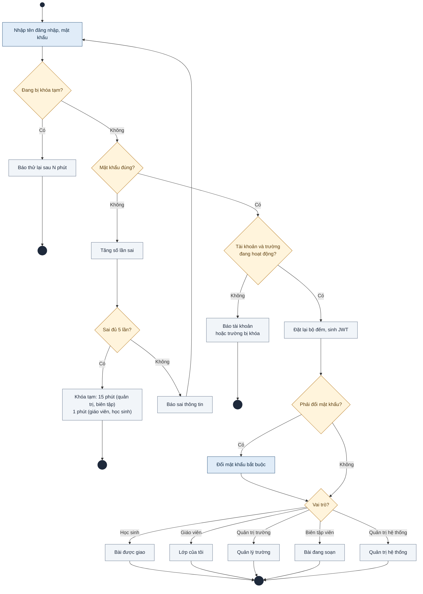

**2. Sơ đồ hoạt động tra cứu bài học**

Người dùng tìm bài theo cấp học, môn, lớp hoặc theo từ khóa. Hệ thống chỉ trả về các bài đã xuất bản; nếu chưa có bài, hệ thống báo nội dung đang được cập nhật.

*Hình 2-7. Sơ đồ hoạt động tra cứu bài học*

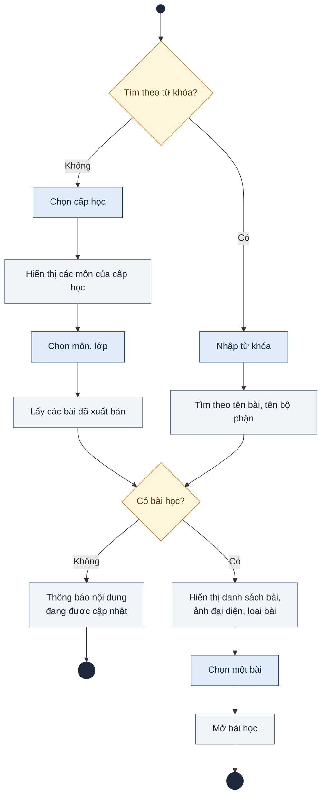

**3. Sơ đồ hoạt động xem phim mở đầu**

Nếu bài học có kịch bản phim, người dùng chọn chế độ Phim; hệ thống chạy hoạt cảnh tổng quan và tháo rời từng bộ phận. Người dùng có thể tạm dừng, tua; hết phim, hệ thống gợi ý chuyển sang chế độ Tự khám phá.

*Hình 2-8. Sơ đồ hoạt động xem phim mở đầu*

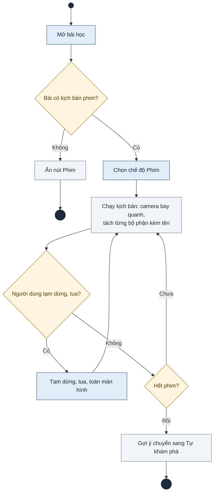

**4. Sơ đồ hoạt động tự khám phá mô hình**

Hệ thống tải mô hình (trình duyệt dùng lại file đã tải nếu bài từng được mở). Người dùng xoay, phóng to, bấm chọn bộ phận; hệ thống làm nổi bật, đưa camera tới, tách bộ phận và hiển thị chú thích. Trên thiết bị yếu, hệ thống tự giảm chất lượng hiển thị.

*Hình 2-9. Sơ đồ hoạt động tự khám phá mô hình*

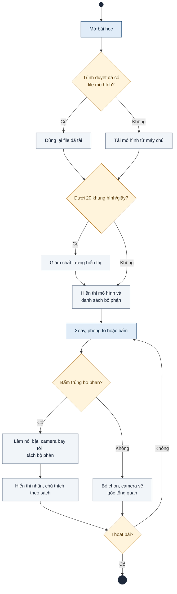

**5. Sơ đồ hoạt động làm thí nghiệm và nộp kết quả**

Người dùng chọn thông số trong khoảng cho phép và thao tác; hệ thống tính kết quả ngay trên máy, cập nhật hiện tượng, số liệu, đồ thị. Khi nộp, máy chủ tự tính lại đáp án từ công thức của bài và thông số học sinh đã chọn rồi mới chấm và lưu; nếu mất kết nối, hệ thống giữ nguyên kết quả trên màn hình để học sinh nộp lại.

*Hình 2-10. Sơ đồ hoạt động làm thí nghiệm và nộp kết quả*

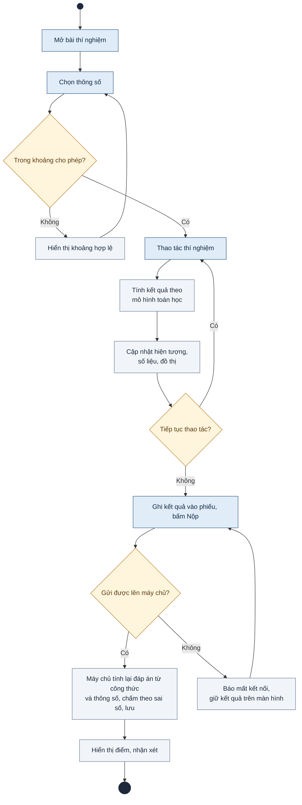

**6. Sơ đồ hoạt động làm bài kiểm tra nhanh**

Hệ thống hiển thị lần lượt từng câu hỏi; người dùng trả lời bằng cách chọn phương án, bấm vào bộ phận trên mô hình hoặc nhập số. Khi nộp, hệ thống nhắc nếu còn câu bỏ trống; bài được chấm và lưu trên máy chủ. Nếu mất kết nối, câu trả lời được giữ trên màn hình để nộp lại.

*Hình 2-11. Sơ đồ hoạt động làm bài kiểm tra nhanh*

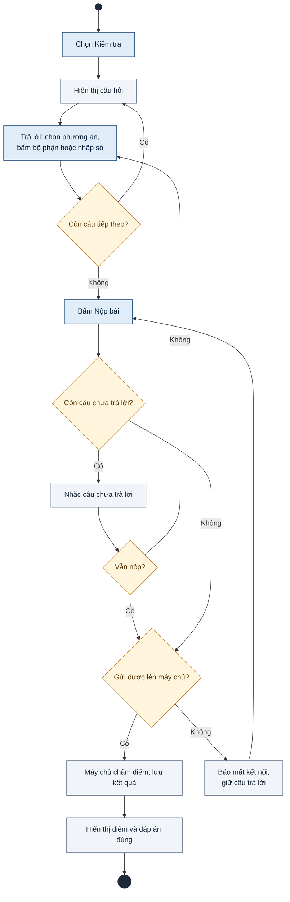

**7. Sơ đồ hoạt động quản lý lớp học**

Giáo viên xem các lớp và môn mình được phân công dạy, chọn lớp để xem danh sách học sinh và tình hình làm bài. Giáo viên chủ nhiệm được đặt lại mật khẩu cho học sinh lớp mình; việc xếp học sinh vào lớp do quản trị trường thực hiện.

*Hình 2-12. Sơ đồ hoạt động quản lý lớp học*

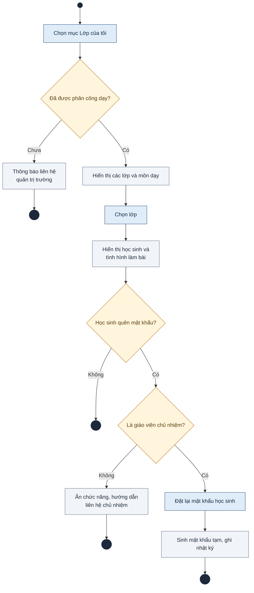

**8. Sơ đồ hoạt động giao bài cho lớp**

Giáo viên chọn bài đã xuất bản, chọn lớp, thời gian mở, hạn nộp và phần yêu cầu. Hệ thống chỉ cho giao bài thuộc môn và khối lớp mà giáo viên được phân công dạy ở lớp đó, kiểm tra thời hạn và việc giao trùng trước khi lưu.

*Hình 2-13. Sơ đồ hoạt động giao bài cho lớp*

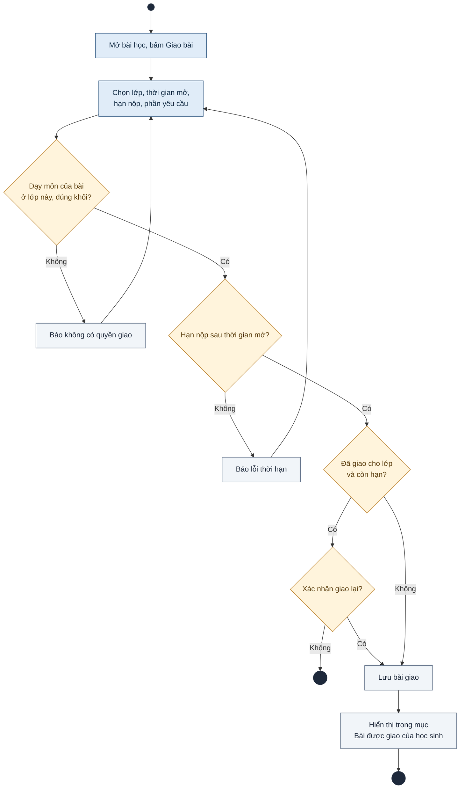

**9. Sơ đồ hoạt động xem, xuất kết quả cả lớp**

Giáo viên chọn lớp và bài giao; hệ thống tổng hợp trạng thái làm bài, điểm và số liệu thí nghiệm của từng học sinh cùng các thống kê chung. Giáo viên có thể xuất bảng kết quả ra file Excel.

*Hình 2-14. Sơ đồ hoạt động xem, xuất kết quả cả lớp*

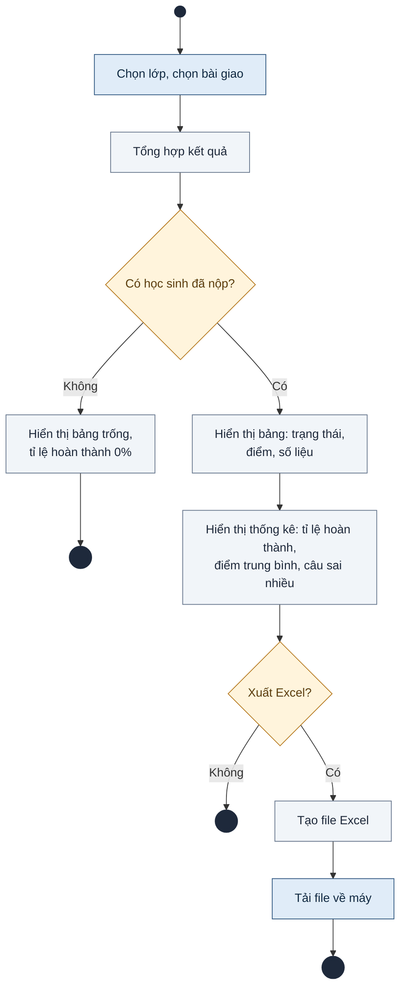

**10. Sơ đồ hoạt động điều khiển màn hình lớp học**

Giáo viên mở phòng lớp học; học sinh vào phòng và nhận trạng thái hiện tại của mô hình. Mỗi thao tác của giáo viên được phát tới học sinh; học sinh mất kết nối sẽ tự kết nối lại và đồng bộ trạng thái mới nhất.

*Hình 2-15. Sơ đồ hoạt động điều khiển màn hình lớp học*

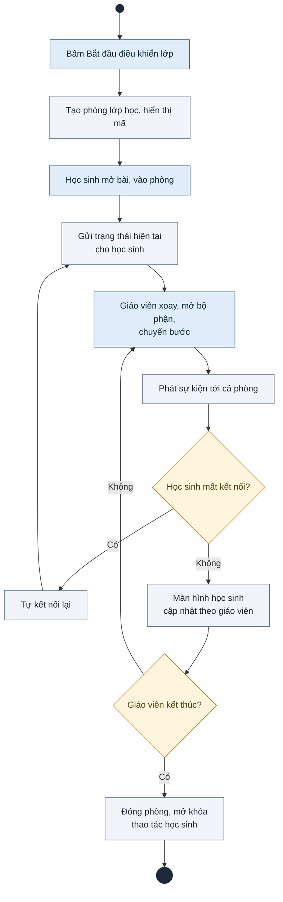

**11. Sơ đồ hoạt động tạo, sửa bài học**

Biên tập viên nhập thông tin bài theo sách, chọn mô hình và khai báo cấu hình, xem trước rồi lưu nháp hoặc xuất bản. Trước khi xuất bản, hệ thống tự kiểm tra bài đã có mô hình, nhãn bộ phận và dòng ghi công (nếu mô hình cần ghi công); không có bước duyệt riêng.

*Hình 2-16. Sơ đồ hoạt động tạo, sửa bài học*

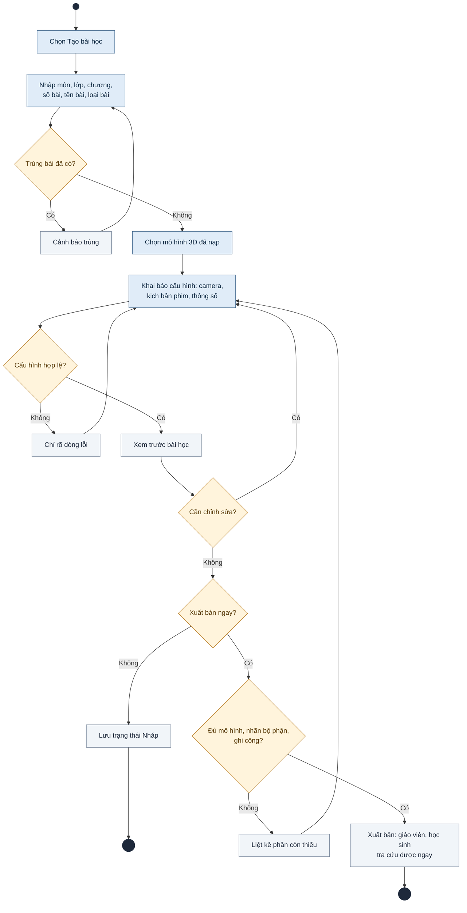

**12. Sơ đồ hoạt động nạp mô hình 3D**

Biên tập viên chọn file và khai báo nguồn. Hệ thống kiểm tra dòng ghi công, rồi kiểm tra kỹ thuật file theo hai mức: vượt mức chặn thì từ chối, vượt mức cảnh báo thì nhắc biên tập viên xác nhận. Mô hình được giữ nguyên chất lượng gốc, không bị nén lại.

*Hình 2-17. Sơ đồ hoạt động nạp mô hình 3D*

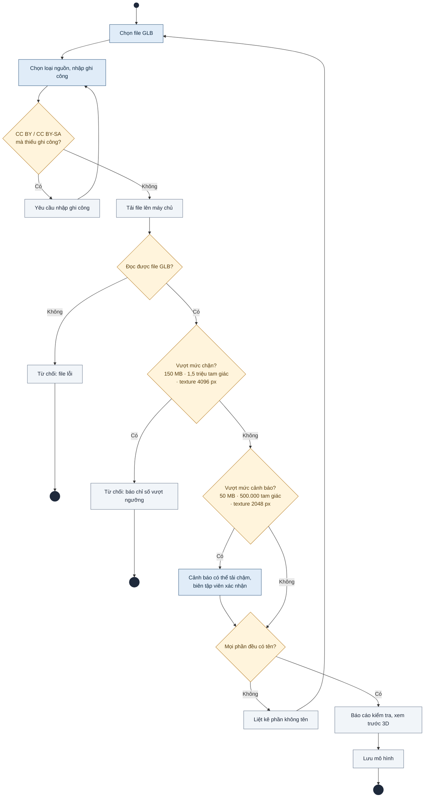

**13. Sơ đồ hoạt động gắn nhãn, chú thích bộ phận**

Hệ thống hiển thị mô hình cùng danh sách các phần đọc từ file. Biên tập viên lần lượt chọn từng phần (có thể gộp nhiều phần vào một bộ phận), nhập nhãn, chú thích theo sách và lưu góc nhìn, sau đó sắp xếp thứ tự và lưu.

*Hình 2-18. Sơ đồ hoạt động gắn nhãn, chú thích bộ phận*

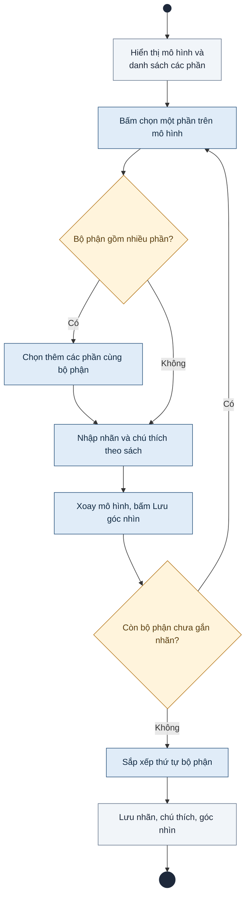

**14. Sơ đồ hoạt động soạn câu hỏi kiểm tra**

Biên tập viên chọn loại câu hỏi và nhập nội dung tương ứng: phương án và đáp án đúng, bộ phận đúng trên mô hình, hoặc đáp án số kèm sai số. Hệ thống không cho lưu câu hỏi chưa có đáp án.

*Hình 2-19. Sơ đồ hoạt động soạn câu hỏi kiểm tra*

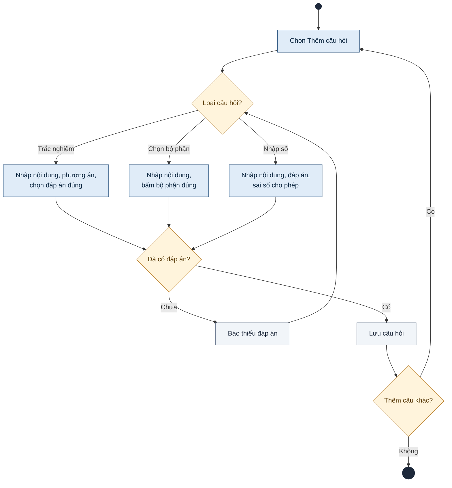

**15. Sơ đồ hoạt động quản lý tài khoản và lớp của trường**

Quản trị trường tạo lớp; phân công giáo viên dạy môn theo lớp (kèm giáo viên chủ nhiệm); nhập tài khoản giáo viên, học sinh hàng loạt từ Excel (hệ thống kiểm tra toàn bộ file, tạo tài khoản kèm hồ sơ, xếp học sinh vào lớp); hoặc sửa, xóa, đặt lại mật khẩu từng tài khoản.

*Hình 2-20. Sơ đồ hoạt động quản lý tài khoản và lớp của trường*

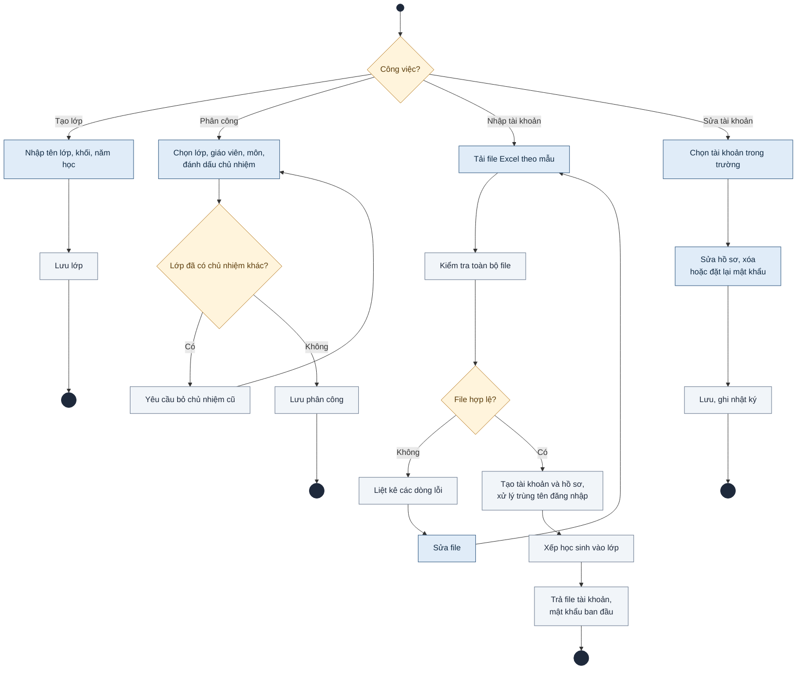

**16. Sơ đồ hoạt động xem kết quả cá nhân**

Học sinh xem danh sách bài được giao và các lần đã nộp cùng trạng thái, điểm; chọn một lần nộp để xem chi tiết số liệu, câu trả lời và đáp án đúng.

*Hình 2-21. Sơ đồ hoạt động xem kết quả cá nhân*

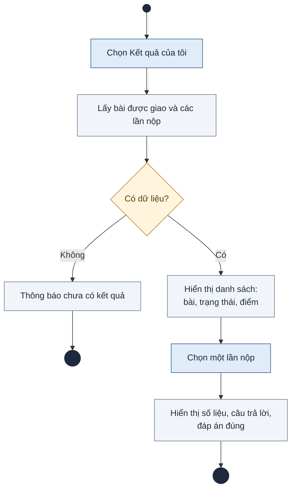

**17. Sơ đồ hoạt động xem nhật ký hệ thống**

Quản trị hệ thống lọc nhật ký theo thời gian, trường, người dùng, loại hành động; hệ thống trả về danh sách bản ghi phù hợp, quản trị hệ thống có thể xem chi tiết từng bản ghi.

*Hình 2-22. Sơ đồ hoạt động xem nhật ký hệ thống*

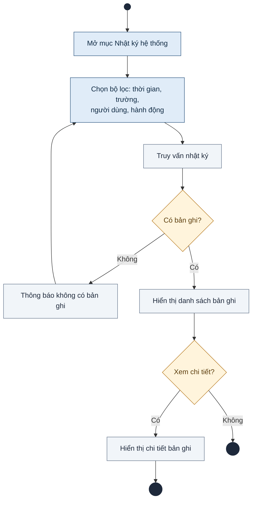

**18. Sơ đồ hoạt động quản lý trường**

Quản trị hệ thống tạo trường mới cùng tài khoản quản trị trường đầu tiên, hoặc khóa, mở khóa một trường. Khi trường bị khóa, mọi tài khoản thuộc trường không đăng nhập được nhưng dữ liệu vẫn được giữ nguyên.

*Hình 2-23. Sơ đồ hoạt động quản lý trường*

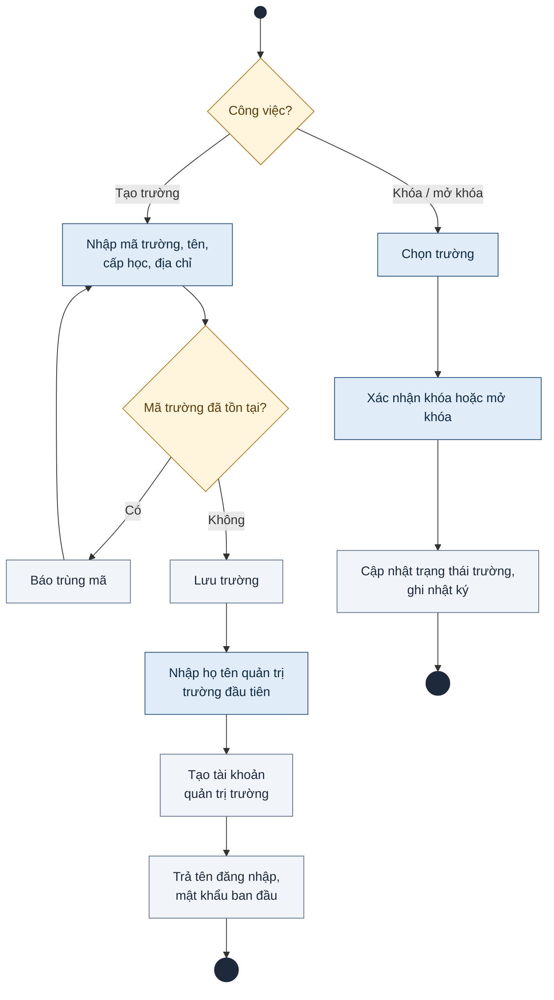

**19. Sơ đồ hoạt động xem báo cáo sử dụng của trường**

Quản trị trường chọn năm học, khối, môn; hệ thống tổng hợp số bài được giao, tỉ lệ học sinh hoàn thành và điểm trung bình theo lớp, theo môn, giúp nhà trường nắm mức độ khai thác phần mềm. Báo cáo có thể xuất ra Excel.

*Hình 2-24. Sơ đồ hoạt động xem báo cáo sử dụng của trường*

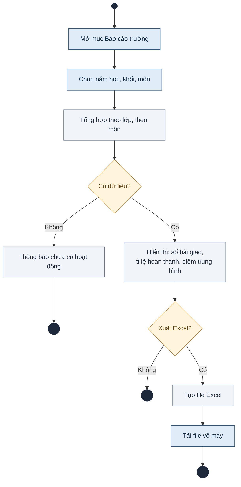

### 2.6.3. Sơ đồ tuần tự

Các sơ đồ tuần tự dưới đây thể hiện luồng Router → Service → Repository → CSDL của kiến trúc đa tầng; thanh dọc trên đường đời thể hiện khoảng thời gian một thành phần đang xử lý (thanh kích hoạt).

**1. Sơ đồ tuần tự đăng nhập**

Người dùng nhập thông tin; giao diện gửi yêu cầu tới API. Tầng Service lấy tài khoản qua Repository, kiểm tra khóa tạm, so khớp mật khẩu đã mã hóa, cập nhật bộ đếm số lần sai; nếu hợp lệ thì sinh access token, refresh token và cho biết tài khoản có phải đổi mật khẩu hay không. Access token trả trong phần thân phản hồi; refresh token được đặt vào cookie httpOnly.

*Hình 2-25. Sơ đồ tuần tự đăng nhập*

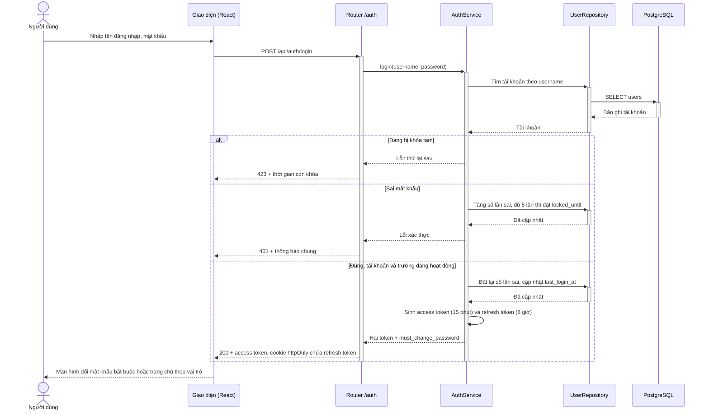

**2. Sơ đồ tuần tự mở bài học**

Giao diện lấy thông tin bài học (cấu hình, nhãn bộ phận, câu hỏi không kèm đáp án) qua API. File mô hình được tải qua CDN; CDN chưa có thì lấy file gốc từ máy chủ trung tâm. Trình duyệt lưu đệm file, nên lần mở sau dùng lại file đã tải.

*Hình 2-26. Sơ đồ tuần tự mở bài học*

```mermaid
sequenceDiagram
    actor HS as Học sinh
    participant FE as Giao diện + Three.js
    participant CDN as CDN
    participant NG as Nginx (máy chủ)
    participant API as Router /lessons
    participant SV as LessonService
    participant RP as LessonRepository
    participant DB as PostgreSQL
    HS->>FE: Chọn bài học
    FE->>+API: GET /api/lessons/{id}
    API->>+SV: get_lesson(id)
    SV->>+RP: Lấy bài học, nhãn bộ phận, câu hỏi
    RP->>+DB: SELECT
    DB-->>-RP: Dữ liệu bài học
    RP-->>-SV: Bài học
    SV-->>-API: Cấu hình bài (bỏ đáp án, công thức chấm)
    API-->>-FE: 200 + cấu hình
    alt Trình duyệt đã có file mô hình
        FE->>FE: Dùng lại file đã tải
    else Chưa có
        FE->>+CDN: GET file .glb
        opt CDN chưa có bản sao
            CDN->>+NG: Lấy file gốc
            NG-->>-CDN: File GLB
        end
        CDN-->>-FE: File GLB (cho phép lưu đệm)
    end
    FE->>FE: Giải nén, dựng mô hình
    FE-->>HS: Hiển thị mô hình 3D
```

**3. Sơ đồ tuần tự nộp kết quả thí nghiệm**

Máy học sinh gửi thông số đã chọn và kết quả ghi nhận. Máy chủ không tin kết quả này: tầng Service lấy công thức đáp án của bài qua Repository, thay thông số học sinh gửi lên để tính lại đáp án, so với kết quả ghi nhận theo sai số cho phép rồi chấm. Bài nộp được lưu bằng INSERT … ON CONFLICT (client_id) DO NOTHING, nên dù học sinh bấm nộp nhiều lần hoặc hai yêu cầu đến cùng lúc cũng chỉ có một bản ghi.

*Hình 2-27. Sơ đồ tuần tự nộp kết quả thí nghiệm*

```mermaid
sequenceDiagram
    actor HS as Học sinh
    participant FE as Giao diện
    participant API as Router /attempts
    participant SV as AttemptService
    participant RP as AttemptRepository
    participant DB as PostgreSQL
    HS->>FE: Bấm Nộp kết quả
    FE->>FE: Sinh client_id (UUID), đóng gói thông số + kết quả ghi nhận
    FE->>+API: POST /api/attempts (JWT)
    API->>API: Kiểm tra JWT, Pydantic kiểm tra dữ liệu
    API->>+SV: submit(attempt)
    SV->>+RP: Lấy công thức đáp án, sai số của bài
    RP->>+DB: SELECT lessons.config
    DB-->>-RP: Công thức, sai số
    RP-->>-SV: Cấu hình chấm
    SV->>SV: Tính lại đáp án từ thông số học sinh gửi lên, so với kết quả ghi nhận, chấm điểm
    SV->>+RP: Lưu bài nộp
    RP->>+DB: INSERT attempts ... ON CONFLICT (client_id) DO NOTHING
    DB-->>-RP: Số dòng đã chèn
    alt 0 dòng (đã nộp trước đó)
        RP->>+DB: SELECT attempts theo client_id
        DB-->>-RP: Bài nộp đã lưu
    end
    RP-->>-SV: Bài nộp
    SV-->>-API: Điểm + nhận xét
    API-->>-FE: 200 + điểm
    FE-->>HS: Hiển thị kết quả
```

**4. Sơ đồ tuần tự nạp mô hình 3D**

File được tải lên máy chủ; tầng Service đọc cấu trúc GLB, đo các chỉ số và đối chiếu với mức chặn, mức cảnh báo. Chỉ khi đạt, file mới được lưu vào thư mục nội dung và bản ghi được ghi vào CSDL qua Repository.

*Hình 2-28. Sơ đồ tuần tự nạp mô hình 3D*

```mermaid
sequenceDiagram
    actor BTV as Biên tập viên
    participant FE as Giao diện
    participant API as Router /assets
    participant SV as AssetService
    participant FS as Thư mục content
    participant RP as AssetRepository
    participant DB as PostgreSQL
    BTV->>FE: Chọn file GLB, loại nguồn, ghi công
    FE->>+API: POST /api/assets (multipart)
    API->>+SV: validate_and_save(file, nguồn, ghi công)
    SV->>SV: Kiểm tra khai báo nguồn, ghi công
    SV->>SV: Đọc GLB: dung lượng, số tam giác, texture, tên mesh
    alt Vượt mức chặn hoặc file lỗi
        SV-->>API: Báo cáo lỗi
        API-->>FE: 422 + chi tiết lỗi
    else Đạt (kèm cảnh báo nếu vượt mức cảnh báo)
        SV->>+FS: Lưu file GLB
        FS-->>-SV: Đường dẫn file
        SV->>+RP: Ghi bản ghi assets
        RP->>+DB: INSERT assets
        DB-->>-RP: Mã mô hình
        RP-->>-SV: Mô hình đã lưu
        SV-->>API: Thông tin mô hình, cảnh báo (nếu có)
        API-->>FE: 201 + danh sách mesh
    end
    deactivate SV
    deactivate API
    FE-->>BTV: Hiển thị báo cáo kiểm tra, xem trước 3D
```

**5. Sơ đồ tuần tự điều khiển màn hình lớp học**

Giáo viên và học sinh kết nối WebSocket tới cùng một phòng trên máy chủ trung tâm. Máy chủ giữ trạng thái mới nhất của phòng trong bộ nhớ để gửi cho học sinh vào muộn, và phát lại mọi sự kiện của giáo viên.

*Hình 2-29. Sơ đồ tuần tự điều khiển màn hình lớp học*

```mermaid
sequenceDiagram
    actor GV as Giáo viên
    participant FG as Giao diện giáo viên
    participant WS as WebSocket /ws/class/{id}
    participant FH as Giao diện học sinh
    actor HS as Học sinh
    GV->>FG: Bắt đầu điều khiển lớp
    FG->>+WS: Kết nối (JWT vai trò Giáo viên), tạo phòng
    HS->>FH: Mở bài học
    FH->>WS: Kết nối (JWT vai trò Học sinh), vào phòng
    WS-->>FH: Trạng thái hiện tại của mô hình
    loop Mỗi thao tác của giáo viên (camera gộp tối đa ~10 lần/giây)
        GV->>FG: Xoay, mở bộ phận, chuyển bước
        FG->>WS: Sự kiện + trạng thái
        WS->>WS: Cập nhật trạng thái phòng
        WS-->>FH: Phát sự kiện tới cả phòng
        FH-->>HS: Mô hình cập nhật theo giáo viên
    end
    GV->>FG: Kết thúc
    FG->>WS: Đóng phòng
    WS-->>FH: Thông báo kết thúc, mở khóa thao tác
    deactivate WS
```

## 2.7. Thiết kế CSDL và mô hình ERD

Hệ thống sử dụng PostgreSQL để lưu trữ dữ liệu. CSDL được thiết kế theo hướng chuẩn hóa cho các dữ liệu cố định (tài khoản, hồ sơ, lớp, bài học), đồng thời dùng kiểu **JSONB** cho các dữ liệu có cấu trúc thay đổi theo từng bài (cấu hình bài học, thông số và số liệu thí nghiệm, phương án câu hỏi).

Một số quyết định thiết kế:

- **Tách thông tin chung và hồ sơ theo vai trò:** bảng `users` chỉ chứa thông tin dùng chung cho mọi tài khoản (đăng nhập, họ tên, liên hệ, vai trò). Thông tin riêng của học sinh và giáo viên nằm ở bảng hồ sơ tương ứng: `student_profiles`, `teacher_profiles`. Quản trị trường, quản trị hệ thống và biên tập viên không cần hồ sơ riêng: bảng `users` (vai trò, trường) đã đủ thông tin cho các vai trò này.
- **Mỗi tài khoản một vai trò:** cột `role` nằm trực tiếp trong `users`; tài khoản thuộc trường có đúng một bản ghi hồ sơ khớp với vai trò (tầng Service kiểm tra khi tạo tài khoản).
- **Trường gắn trực tiếp vào tài khoản:** bảng `users` có cột `school_id` (NULL với biên tập viên và quản trị hệ thống) khai báo ON DELETE CASCADE, nên xóa trường thì CSDL tự xóa luôn mọi tài khoản của trường, không cần phần mềm xử lý riêng. Cột `school_id` ở các bảng hồ sơ giữ lại để ràng buộc mã học sinh không trùng trong một trường; tầng Service đảm bảo hai giá trị luôn khớp nhau. Mã trường được đưa vào JWT khi đăng nhập để giới hạn dữ liệu.
- **Lớp học tách thành hai quan hệ:** `class_students` (học sinh thuộc lớp nào) và `class_teachers` (giáo viên dạy môn gì ở lớp nào, có chủ nhiệm không). Nhờ biết môn dạy, giáo viên chỉ giao được bài đúng môn, đúng khối; nhà trường có báo cáo theo môn.
- **Nhãn bộ phận gắn với bài học, không gắn với mô hình:** cùng một mô hình có thể dùng cho hai bài ở hai lớp khác nhau với mức chú thích khác nhau.
- **Thông tin bản quyền tối giản:** bảng mô hình chỉ có hai cột `source_type` và `attribution`, theo quy định chọn mô hình ở mục 1.4.4.
- **Chỉ lưu bài nộp của học sinh:** giáo viên làm thử bài học để chuẩn bị giảng không được lưu kết quả.
- **Phòng lớp học thời gian thực không lưu CSDL:** trạng thái phòng chỉ giữ trong bộ nhớ máy chủ trong thời gian giảng, kết thúc là xóa.
- **Mã định danh do máy học sinh sinh ra (`client_id`)** cho mỗi lần nộp bài; khi lưu dùng INSERT … ON CONFLICT (client_id) DO NOTHING dựa trên ràng buộc UNIQUE, nên bấm nộp nhiều lần, nộp lại sau khi mất kết nối hay hai yêu cầu đến cùng lúc đều không ghi trùng.
- **Đáp án thí nghiệm là công thức, không phải con số:** vì đáp án phụ thuộc thông số học sinh chọn (ví dụ Ca, Va, Cb), `lessons.config` lưu công thức đáp án (ví dụ `Vb = Ca * Va / Cb`) và sai số cho phép. Máy chủ đọc công thức bằng bộ tính biểu thức an toàn (chỉ cho phép phép toán và hàm số học, không chạy mã tùy ý), thay thông số học sinh gửi lên để tính lại đáp án rồi mới chấm; máy học sinh dùng cùng công thức để phản hồi tức thì.
- **Chống dò mật khẩu:** bảng `users` lưu số lần đăng nhập sai liên tiếp và thời điểm hết khóa tạm; cột `must_change_password` đánh dấu tài khoản phải đổi mật khẩu ở lần đăng nhập tới. Cột `token_version` dùng để thu hồi refresh token: đổi mật khẩu, được đặt lại mật khẩu hoặc bị khóa tài khoản thì giá trị tăng thêm 1, mọi refresh token mang số cũ bị từ chối.
- **Xóa hẳn, có quy tắc lan truyền:** xóa tài khoản học sinh xóa luôn hồ sơ, xếp lớp và bài nộp (ON DELETE CASCADE); xóa giáo viên, biên tập viên chỉ bỏ thông tin người tạo ở bài giao, bài học, mô hình (ON DELETE SET NULL); xóa trường xóa toàn bộ dữ liệu của trường, kể cả tài khoản; bài nộp không còn bài giao thì cột bài giao thành NULL (ON DELETE SET NULL); nhật ký giữ lại, cột người dùng và trường thành NULL, tên tài khoản vẫn lưu trong cột `detail`.
- **Tạo hồ sơ là tạo tài khoản:** bản ghi `users` và bản ghi hồ sơ được tạo trong cùng một giao dịch; tên đăng nhập tự sinh theo mã trường + mã học sinh / mã giáo viên, mật khẩu ban đầu ngẫu nhiên chỉ lưu dạng mã hóa.
- **Dữ liệu cá nhân tối thiểu:** ngày sinh, giới tính, thông tin phụ huynh là cột không bắt buộc (theo Nghị định 13/2023/NĐ-CP).

### 2.7.1. Các bảng chính

**a) Nhóm tổ chức và người dùng (7 bảng)**

- **schools:** thông tin trường học và trạng thái hoạt động.
- **users:** thông tin chung của mọi tài khoản: tên đăng nhập, mật khẩu, họ tên, liên hệ, vai trò (SYSTEM_ADMIN, CONTENT_EDITOR, SCHOOL_ADMIN, TEACHER, STUDENT).
- **student_profiles:** hồ sơ học sinh – trường, mã học sinh, ngày sinh, giới tính, thông tin phụ huynh.
- **teacher_profiles:** hồ sơ giáo viên – trường, mã giáo viên, tổ chuyên môn, chức vụ trong tổ.
- **classes:** lớp học (tên lớp, khối, năm học).
- **class_students:** học sinh thuộc lớp nào (một học sinh thuộc một lớp trong mỗi năm học).
- **class_teachers:** phân công giảng dạy – giáo viên dạy môn gì ở lớp nào, ai là giáo viên chủ nhiệm.

**b) Nhóm nội dung (5 bảng)**

- **subjects:** môn học (Khoa học, Khoa học tự nhiên, Vật lí, Hóa học, Sinh học).
- **assets:** mô hình 3D đã nạp, kèm kết quả kiểm tra kỹ thuật, loại nguồn và dòng ghi công.
- **lessons:** bài học, gắn với môn, lớp, vị trí trong sách, mô hình; cấu hình bài lưu dạng JSONB; có trạng thái nháp / đã xuất bản.
- **lesson_parts:** nhãn, chú thích, góc camera của từng bộ phận trong bài học.
- **questions:** câu hỏi kiểm tra nhanh của bài học, kèm đáp án và sai số cho phép.

**c) Nhóm học tập (2 bảng)**

- **assignments:** bài giao của giáo viên cho lớp, kèm thời hạn.
- **attempts:** mỗi lần học sinh nộp kết quả thí nghiệm hoặc bài kiểm tra; số liệu và câu trả lời lưu dạng JSONB.

**d) Nhóm hệ thống (1 bảng)**

- **system_logs:** nhật ký các thao tác quan trọng (đăng nhập, nạp mô hình, xuất bản và gỡ xuất bản bài, khóa tài khoản, khóa trường, đặt lại mật khẩu).

### 2.7.2. Mô hình ER

Thực thể trung tâm của hệ thống là **Lesson** (bài học). Mỗi Lesson thuộc một Subject, sử dụng một Asset (mô hình 3D), có nhiều LessonPart (bộ phận) và nhiều Question. Lesson được giao cho lớp thông qua Assignment.

Thực thể **User** chứa thông tin chung của mọi tài khoản và thuộc một **School** (trừ biên tập viên, quản trị hệ thống). User là học sinh hoặc giáo viên có đúng một hồ sơ: **StudentProfile** hoặc **TeacherProfile** (quan hệ một – một); mỗi hồ sơ thuộc một **School**. User là quản trị trường không có hồ sơ riêng, chỉ cần vai trò và trường trong bảng users. User vai trò Biên tập viên nạp Asset, tạo và xuất bản Lesson; mọi User đều có thể có các bản ghi SystemLog.

Thực thể **Class** thuộc một School. Học sinh tham gia lớp qua **ClassStudent**; giáo viên được phân công dạy một môn ở lớp qua **ClassTeacher** (nối Class, TeacherProfile và Subject).

Thực thể **Assignment** do một giáo viên tạo, giao một Lesson cho một Class. Thực thể **Attempt** liên kết học sinh với bài học, và liên kết với Assignment nếu bài làm thuộc một bài giao (học sinh tự học thì không có Assignment).

*Hình 2-30. Mô hình ER*

```mermaid
flowchart LR
    School["School"] -->|"1–n"| User["User"]
    User -->|"1–1"| SP["StudentProfile"]
    User -->|"1–1"| TP["TeacherProfile"]
    School -->|"1–n"| SP
    School -->|"1–n"| TP
    School -->|"1–n"| Class["Class"]
    Class -->|"1–n"| CS["ClassStudent"]
    SP -->|"1–n"| CS
    Class -->|"1–n"| CT["ClassTeacher"]
    TP -->|"1–n"| CT
    Subject["Subject"] -->|"1–n"| CT
    Subject -->|"1–n"| Lesson["Lesson"]
    Asset["Asset"] -->|"1–n"| Lesson
    Lesson -->|"1–n"| LessonPart["LessonPart"]
    Lesson -->|"1–n"| Question["Question"]
    Class -->|"1–n"| Assignment["Assignment"]
    Lesson -->|"1–n"| Assignment
    TP -->|"1–n"| Assignment
    SP -->|"1–n"| Attempt["Attempt"]
    Lesson -->|"1–n"| Attempt
    Assignment -->|"1–n"| Attempt
    User -->|"1–n"| SystemLog["SystemLog"]
```

### 2.7.3. Thiết kế các bảng CSDL

**1. Nhóm tổ chức và người dùng**

*Bảng 2-31. Bảng schools*

| Tên cột | Kiểu dữ liệu | Ràng buộc | Mô tả |
|---|---|---|---|
| id | SERIAL | Primary Key | Mã trường |
| code | VARCHAR(20) | UNIQUE, NOT NULL | Mã trường (dùng khi nhập tài khoản) |
| name | TEXT | NOT NULL | Tên trường |
| level | VARCHAR(20) | CHECK (PRIMARY, LOWER_SECONDARY, UPPER_SECONDARY, MULTI) | Cấp học của trường |
| address | TEXT | | Địa chỉ |
| is_active | BOOLEAN | DEFAULT true | Trường đang sử dụng / tạm ngừng (khóa) |
| created_at | TIMESTAMP | DEFAULT now() | Ngày tạo |

*Bảng 2-32. Bảng users*

| Tên cột | Kiểu dữ liệu | Ràng buộc | Mô tả |
|---|---|---|---|
| id | SERIAL | Primary Key | Mã người dùng |
| school_id | INT | FK (schools) ON DELETE CASCADE, NULL được | Trường của tài khoản; NULL với biên tập viên, quản trị hệ thống. Xóa trường thì tài khoản bị xóa theo |
| username | VARCHAR(50) | UNIQUE, NOT NULL | Tên đăng nhập; tài khoản trường tự sinh: mã trường + mã học sinh / mã giáo viên |
| password_hash | TEXT | NOT NULL | Mật khẩu mã hóa bcrypt |
| full_name | TEXT | NOT NULL | Họ và tên |
| email | VARCHAR(100) | | Thư điện tử (không bắt buộc với học sinh) |
| phone | VARCHAR(15) | | Số điện thoại |
| avatar_url | TEXT | | Ảnh đại diện |
| role | VARCHAR(15) | CHECK (SYSTEM_ADMIN, CONTENT_EDITOR, SCHOOL_ADMIN, TEACHER, STUDENT), NOT NULL | Vai trò – mỗi tài khoản một vai trò |
| is_active | BOOLEAN | DEFAULT true | Trạng thái hoạt động / bị khóa |
| last_login_at | TIMESTAMP | | Lần đăng nhập gần nhất |
| must_change_password | BOOLEAN | DEFAULT false | Phải đổi mật khẩu ở lần đăng nhập tới (quản trị trường, quản trị hệ thống, biên tập viên khi mới tạo hoặc vừa được đặt lại) |
| failed_login_count | SMALLINT | DEFAULT 0 | Số lần đăng nhập sai liên tiếp |
| locked_until | TIMESTAMP | | Khóa tạm tới thời điểm này (15 phút với quản trị, biên tập; 1 phút với giáo viên, học sinh) |
| token_version | INT | DEFAULT 0 | Phiên bản token; tăng thêm 1 khi đổi mật khẩu, được đặt lại mật khẩu hoặc bị khóa tài khoản, làm mọi refresh token cũ mất hiệu lực |
| created_at | TIMESTAMP | DEFAULT now() | Ngày tạo |

*Bảng 2-33. Bảng student_profiles*

| Tên cột | Kiểu dữ liệu | Ràng buộc | Mô tả |
|---|---|---|---|
| user_id | INT | PK, FK (users) ON DELETE CASCADE | Tài khoản học sinh |
| school_id | INT | FK (schools) ON DELETE CASCADE, NOT NULL | Trường (khớp với users.school_id) |
| student_code | VARCHAR(20) | NOT NULL | Mã học sinh |
| date_of_birth | DATE | | Ngày sinh (không bắt buộc) |
| gender | VARCHAR(6) | CHECK (MALE, FEMALE) | Giới tính (không bắt buộc) |
| parent_name | TEXT | | Họ tên phụ huynh (không bắt buộc) |
| parent_phone | VARCHAR(15) | | Số điện thoại phụ huynh (không bắt buộc) |
| | (school_id, student_code) | UNIQUE | Không trùng mã học sinh trong một trường |

*Bảng 2-34. Bảng teacher_profiles*

| Tên cột | Kiểu dữ liệu | Ràng buộc | Mô tả |
|---|---|---|---|
| user_id | INT | PK, FK (users) ON DELETE CASCADE | Tài khoản giáo viên |
| school_id | INT | FK (schools) ON DELETE CASCADE, NOT NULL | Trường (khớp với users.school_id) |
| teacher_code | VARCHAR(20) | | Mã giáo viên |
| department | TEXT | | Tổ chuyên môn (ví dụ: Tổ Khoa học tự nhiên) |
| position | VARCHAR(12) | CHECK (TEACHER, HEAD, DEPUTY_HEAD), DEFAULT 'TEACHER' | Chức vụ trong tổ: giáo viên / tổ trưởng / tổ phó |

*Bảng 2-35. Bảng classes*

| Tên cột | Kiểu dữ liệu | Ràng buộc | Mô tả |
|---|---|---|---|
| id | SERIAL | Primary Key | Mã lớp |
| school_id | INT | FK (schools) ON DELETE CASCADE, NOT NULL | Trường |
| name | VARCHAR(20) | NOT NULL | Tên lớp (ví dụ: 7A1) |
| grade | SMALLINT | CHECK (1–12) | Khối lớp |
| school_year | VARCHAR(9) | NOT NULL | Năm học (ví dụ: 2026-2027) |
| | (school_id, name, school_year) | UNIQUE | Không trùng tên lớp trong một năm học |

*Bảng 2-36. Bảng class_students*

| Tên cột | Kiểu dữ liệu | Ràng buộc | Mô tả |
|---|---|---|---|
| class_id | INT | FK (classes) ON DELETE CASCADE | Lớp |
| student_id | INT | FK (student_profiles) ON DELETE CASCADE | Học sinh |
| | (class_id, student_id) | PRIMARY KEY | Chống trùng; tầng Service đảm bảo mỗi học sinh chỉ thuộc một lớp trong một năm học |

*Bảng 2-37. Bảng class_teachers*

| Tên cột | Kiểu dữ liệu | Ràng buộc | Mô tả |
|---|---|---|---|
| class_id | INT | FK (classes) ON DELETE CASCADE | Lớp |
| teacher_id | INT | FK (teacher_profiles) ON DELETE CASCADE | Giáo viên |
| subject_id | INT | FK (subjects), NOT NULL | Môn được phân công dạy ở lớp |
| is_homeroom | BOOLEAN | DEFAULT false | Là giáo viên chủ nhiệm |
| | (class_id, teacher_id, subject_id) | PRIMARY KEY | Chống trùng phân công |
| | (class_id) WHERE is_homeroom | UNIQUE (chỉ mục một phần) | Mỗi lớp tối đa một giáo viên chủ nhiệm |

**2. Nhóm nội dung**

*Bảng 2-38. Bảng subjects*

| Tên cột | Kiểu dữ liệu | Ràng buộc | Mô tả |
|---|---|---|---|
| id | SERIAL | Primary Key | Mã môn |
| code | VARCHAR(20) | UNIQUE, NOT NULL | Mã môn (KHOA_HOC, KHTN, VAT_LI, HOA_HOC, SINH_HOC) |
| name | TEXT | NOT NULL | Tên môn hiển thị |
| min_grade | SMALLINT | | Lớp thấp nhất có môn |
| max_grade | SMALLINT | | Lớp cao nhất có môn |

*Bảng 2-39. Bảng assets*

| Tên cột | Kiểu dữ liệu | Ràng buộc | Mô tả |
|---|---|---|---|
| id | SERIAL | Primary Key | Mã mô hình |
| name | TEXT | NOT NULL | Tên mô hình |
| file_path | TEXT | NOT NULL | Đường dẫn file GLB trong thư mục nội dung |
| file_size | INT | | Dung lượng (byte) |
| triangle_count | INT | | Số tam giác |
| max_texture_px | INT | | Cạnh texture lớn nhất (pixel) |
| mesh_names | JSONB | | Danh sách tên các phần trong mô hình |
| source_type | VARCHAR(20) | CHECK (SELF_BUILT, COMMISSIONED, CC0, CC_BY, CC_BY_SA) | Loại nguồn |
| attribution | TEXT | CHECK: bắt buộc có khi source_type là CC_BY, CC_BY_SA | Dòng ghi công hiển thị trong bài |
| uploaded_by | INT | FK (users) ON DELETE SET NULL | Biên tập viên nạp |
| created_at | TIMESTAMP | DEFAULT now() | Thời điểm nạp |

*Bảng 2-40. Bảng lessons*

| Tên cột | Kiểu dữ liệu | Ràng buộc | Mô tả |
|---|---|---|---|
| id | SERIAL | Primary Key | Mã bài học |
| subject_id | INT | FK (subjects), NOT NULL | Môn học |
| grade | SMALLINT | CHECK (1–12) | Lớp |
| book_series | VARCHAR(30) | DEFAULT 'KNTT' | Bộ sách |
| chapter | TEXT | | Chương / chủ đề |
| lesson_no | SMALLINT | | Số bài trong sách |
| title | TEXT | NOT NULL | Tên bài |
| lesson_type | VARCHAR(12) | CHECK (STRUCTURE, EXPERIMENT) | Loại bài: cấu tạo / thí nghiệm |
| asset_id | INT | FK (assets) | Mô hình 3D sử dụng |
| config | JSONB | | Cấu hình: góc camera, kịch bản phim; với bài thí nghiệm: thông số và khoảng giá trị, công thức đáp án theo thông số, sai số cho phép |
| thumbnail_path | TEXT | | Ảnh đại diện |
| status | VARCHAR(10) | CHECK (DRAFT, PUBLISHED), DEFAULT 'DRAFT' | Nháp / đã xuất bản |
| created_by | INT | FK (users) ON DELETE SET NULL | Biên tập viên tạo bài |
| published_by | INT | FK (users) ON DELETE SET NULL | Biên tập viên xuất bản lần gần nhất |
| published_at | TIMESTAMP | | Thời điểm xuất bản |
| updated_at | TIMESTAMP | DEFAULT now() | Thời điểm cập nhật |

*Bảng 2-41. Bảng lesson_parts*

| Tên cột | Kiểu dữ liệu | Ràng buộc | Mô tả |
|---|---|---|---|
| id | SERIAL | Primary Key | Mã bộ phận |
| lesson_id | INT | FK (lessons) ON DELETE CASCADE | Bài học |
| mesh_names | JSONB | NOT NULL | Một hoặc nhiều tên mesh thuộc bộ phận (ví dụ hai mắt) |
| label | TEXT | NOT NULL | Nhãn hiển thị (ví dụ: "Vây lưng") |
| description | TEXT | | Chú thích 1–2 câu theo sách |
| camera_view | JSONB | | Góc camera khi chọn bộ phận |
| sort_order | SMALLINT | DEFAULT 0 | Thứ tự trong danh sách |

*Bảng 2-42. Bảng questions*

| Tên cột | Kiểu dữ liệu | Ràng buộc | Mô tả |
|---|---|---|---|
| id | SERIAL | Primary Key | Mã câu hỏi |
| lesson_id | INT | FK (lessons) ON DELETE CASCADE | Bài học |
| question_type | VARCHAR(12) | CHECK (CHOICE, PICK_PART, NUMERIC) | Trắc nghiệm / chọn bộ phận / nhập số |
| content | TEXT | NOT NULL | Nội dung câu hỏi |
| options | JSONB | | Các phương án (câu trắc nghiệm) |
| answer | JSONB | NOT NULL | Đáp án; không bao giờ gửi xuống máy học sinh trước khi nộp |
| tolerance | NUMERIC | | Sai số cho phép (câu nhập số) |
| sort_order | SMALLINT | DEFAULT 0 | Thứ tự câu |

**3. Nhóm học tập**

*Bảng 2-43. Bảng assignments*

| Tên cột | Kiểu dữ liệu | Ràng buộc | Mô tả |
|---|---|---|---|
| id | SERIAL | Primary Key | Mã bài giao |
| class_id | INT | FK (classes) ON DELETE CASCADE, NOT NULL | Lớp được giao |
| lesson_id | INT | FK (lessons), NOT NULL | Bài học |
| assigned_by | INT | FK (teacher_profiles) ON DELETE SET NULL | Giáo viên giao (NULL nếu giáo viên đã bị xóa); tầng Service kiểm tra giáo viên dạy môn của bài ở lớp này |
| requirement | VARCHAR(12) | CHECK (EXPERIMENT, QUIZ, BOTH) | Phần yêu cầu |
| open_at | TIMESTAMP | NOT NULL | Thời gian mở |
| due_at | TIMESTAMP | CHECK (due_at > open_at) | Hạn nộp |
| created_at | TIMESTAMP | DEFAULT now() | Ngày giao |

*Bảng 2-44. Bảng attempts*

| Tên cột | Kiểu dữ liệu | Ràng buộc | Mô tả |
|---|---|---|---|
| id | SERIAL | Primary Key | Mã lần nộp |
| client_id | UUID | UNIQUE, NOT NULL | Mã do máy học sinh sinh ra, chống ghi trùng khi nộp lại |
| student_id | INT | FK (student_profiles) ON DELETE CASCADE, NOT NULL | Học sinh; xóa học sinh xóa luôn bài nộp |
| lesson_id | INT | FK (lessons), NOT NULL | Bài học |
| assignment_id | INT | FK (assignments) ON DELETE SET NULL, NULL được | Bài giao (NULL nếu tự học hoặc bài giao đã bị xóa) |
| attempt_type | VARCHAR(12) | CHECK (EXPERIMENT, QUIZ) | Loại bài nộp |
| experiment_data | JSONB | | Thông số đã chọn, số liệu đo, kết quả ghi nhận |
| answers | JSONB | | Câu trả lời bài kiểm tra |
| score | NUMERIC(4,2) | | Điểm (thang 10) |
| submitted_at | TIMESTAMP | NOT NULL | Thời điểm học sinh nộp (theo máy học sinh) |
| synced_at | TIMESTAMP | DEFAULT now() | Thời điểm máy chủ nhận |

**4. Nhóm hệ thống**

*Bảng 2-45. Bảng system_logs*

| Tên cột | Kiểu dữ liệu | Ràng buộc | Mô tả |
|---|---|---|---|
| id | BIGSERIAL | Primary Key | Mã nhật ký |
| user_id | INT | FK (users) ON DELETE SET NULL | Người thực hiện (tên tài khoản lưu kèm trong `detail`) |
| school_id | INT | FK (schools) ON DELETE SET NULL, NULL được | Trường liên quan (để lọc nhật ký theo trường); xóa trường thì nhật ký vẫn giữ |
| action | VARCHAR(30) | NOT NULL | Hành động (LOGIN, CREATE_STUDENT, IMPORT_STUDENTS, DELETE_STUDENT, DELETE_TEACHER, RESET_PASSWORD, LOCK_SCHOOL, DELETE_SCHOOL, PUBLISH_LESSON…) |
| target_type | VARCHAR(20) | | Đối tượng tác động (lesson, asset, user, school…) |
| target_id | INT | | Mã đối tượng |
| detail | JSONB | | Chi tiết bổ sung |
| created_at | TIMESTAMP | DEFAULT now() | Thời gian thực hiện |

### 2.7.4. Sơ đồ ERD

Sơ đồ ERD thể hiện các bảng, khóa chính, khóa ngoại và quan hệ giữa các bảng, giúp kiểm tra lại tính hợp lý của thiết kế và hỗ trợ triển khai, bảo trì về sau.

*Hình 2-31. Sơ đồ ERD*

```mermaid
erDiagram
    schools ||--o{ users : "có"
    users ||--o| student_profiles : "hồ sơ"
    users ||--o| teacher_profiles : "hồ sơ"
    schools ||--o{ student_profiles : "có"
    schools ||--o{ teacher_profiles : "có"
    schools ||--o{ classes : "có"
    classes ||--o{ class_students : "gồm"
    student_profiles ||--o{ class_students : "thuộc"
    classes ||--o{ class_teachers : "được dạy"
    teacher_profiles ||--o{ class_teachers : "dạy"
    subjects ||--o{ class_teachers : "môn"
    subjects ||--o{ lessons : "thuộc"
    assets ||--o{ lessons : "dùng trong"
    lessons ||--o{ lesson_parts : "có"
    lessons ||--o{ questions : "có"
    classes ||--o{ assignments : "được giao"
    lessons ||--o{ assignments : "được giao"
    teacher_profiles ||--o{ assignments : "giao"
    student_profiles ||--o{ attempts : "nộp"
    lessons ||--o{ attempts : "của"
    assignments |o--o{ attempts : "thuộc"
    users ||--o{ assets : "nạp"
    users ||--o{ lessons : "tạo, xuất bản"
    users ||--o{ system_logs : "thực hiện"

    schools {
        int id PK
        varchar code UK
        text name
        varchar level
        boolean is_active
    }
    users {
        int id PK
        int school_id FK
        varchar username UK
        text password_hash
        text full_name
        varchar email
        varchar phone
        varchar role
        boolean is_active
        boolean must_change_password
        timestamp locked_until
    }
    student_profiles {
        int user_id PK,FK
        int school_id FK
        varchar student_code
        date date_of_birth
        varchar parent_phone
    }
    teacher_profiles {
        int user_id PK,FK
        int school_id FK
        varchar teacher_code
        text department
        varchar position
    }
    classes {
        int id PK
        int school_id FK
        varchar name
        smallint grade
        varchar school_year
    }
    class_students {
        int class_id PK,FK
        int student_id PK,FK
    }
    class_teachers {
        int class_id PK,FK
        int teacher_id PK,FK
        int subject_id PK,FK
        boolean is_homeroom
    }
    subjects {
        int id PK
        varchar code UK
        text name
    }
    assets {
        int id PK
        text file_path
        int triangle_count
        jsonb mesh_names
        varchar source_type
        text attribution
        int uploaded_by FK
    }
    lessons {
        int id PK
        int subject_id FK
        smallint grade
        smallint lesson_no
        text title
        varchar lesson_type
        int asset_id FK
        jsonb config
        varchar status
        int created_by FK
        int published_by FK
    }
    lesson_parts {
        int id PK
        int lesson_id FK
        jsonb mesh_names
        text label
        text description
    }
    questions {
        int id PK
        int lesson_id FK
        varchar question_type
        jsonb answer
        numeric tolerance
    }
    assignments {
        int id PK
        int class_id FK
        int lesson_id FK
        int assigned_by FK
        timestamp open_at
        timestamp due_at
    }
    attempts {
        int id PK
        uuid client_id UK
        int student_id FK
        int lesson_id FK
        int assignment_id FK
        jsonb experiment_data
        jsonb answers
        numeric score
    }
    system_logs {
        bigint id PK
        int user_id FK
        int school_id FK
        varchar action
        jsonb detail
    }
```

Bảng **users** chứa thông tin chung, thuộc một trường trong **schools** (xóa trường thì tài khoản bị xóa theo) và có quan hệ một – một (không bắt buộc) với hai bảng hồ sơ **student_profiles**, **teacher_profiles**; mỗi hồ sơ thuộc một trường trong **schools**. Tài khoản quản trị trường chỉ nằm trong **users**. Lớp học (**classes**) liên kết với học sinh qua **class_students** và với giáo viên qua **class_teachers** – bảng phân công giảng dạy có thêm môn học và cờ chủ nhiệm.

Thực thể trung tâm của phần nội dung là bảng **lessons**, liên kết với **subjects** và **assets** theo quan hệ nhiều – một; mỗi bài học có nhiều **lesson_parts** và **questions**. Bài học được giáo viên giao cho lớp qua **assignments**; mỗi lần nộp bài của học sinh lưu ở **attempts**, có thể gắn hoặc không gắn với một bài giao. Bảng **system_logs** ghi lại thao tác của người dùng, có thể lọc theo trường.

Nhìn chung, thiết kế CSDL tách rõ bốn phần: tổ chức (trường, người dùng, hồ sơ, lớp, phân công), nội dung (bài học, mô hình, bộ phận, câu hỏi), học tập (bài giao, bài nộp) và hệ thống (nhật ký), đảm bảo toàn vẹn dữ liệu và thuận lợi mở rộng thêm vai trò, môn học, bài học mới.

## 2.8. Sơ đồ triển khai

Hệ thống được triển khai theo mô hình **một máy chủ trung tâm cho tất cả các trường**. Biên tập viên xuất bản bài học một lần là mọi trường dùng được ngay; quản trị hệ thống quản lý tập trung các trường; chỉ có một nơi cần cập nhật phần mềm. Nhà trường không cài đặt gì, giáo viên và học sinh chỉ cần trình duyệt và kết nối Internet.

*Hình 2-32. Sơ đồ triển khai hệ thống*


Các thành phần trên sơ đồ:

- **Máy tính / máy tính bảng của học sinh, giáo viên:** trình duyệt chạy giao diện React + Three.js, dựng hình 3D và tính kết quả thí nghiệm tại chỗ; file mô hình đã tải được lưu đệm trong trình duyệt.
- **Mạng phân phối nội dung (CDN):** giữ bản sao file mô hình GLB ở gần người dùng, giảm tải cho máy chủ trung tâm khi nhiều trường cùng mở bài; khi chưa có bản sao thì lấy file gốc từ máy chủ.
- **Máy chủ trung tâm** (đặt tại trung tâm dữ liệu trong nước) chạy Docker Compose với ba container: **web** (Nginx – phục vụ giao diện, file GLB gốc, mã hóa HTTPS), **api** (FastAPI – REST API, WebSocket, chấm bài), **db** (PostgreSQL). File mô hình gốc nằm trong volume content; dữ liệu nằm trong volume pgdata trên ổ đĩa mã hóa.
- **Kho sao lưu tách biệt:** nhận bản sao lưu CSDL đã mã hóa hằng ngày, giữ tối thiểu 30 ngày.

Mọi kết nối từ trình duyệt dùng HTTPS (WSS cho chế độ điều khiển lớp học). Giai đoạn thử nghiệm chạy một bản container api, đủ cho số người dùng dự kiến. Khi số trường tăng và cần chạy nhiều bản api phía sau Nginx, các phòng lớp học của chế độ điều khiển lớp chuyển sang dùng Redis để chuyển sự kiện giữa các bản (phòng lớp học hiện chỉ nằm trong bộ nhớ của một bản api; nếu không có Redis, giáo viên kết nối vào bản này còn học sinh vào bản kia sẽ không nhận được thao tác của nhau).

## 2.9. Kết chương

Chương này đã phân tích bài toán, khảo sát thực tế và các hệ thống tương tự, xác định năm nhóm người dùng (Học sinh, Giáo viên, Quản trị trường, Biên tập viên, Quản trị hệ thống) – mỗi tài khoản một vai trò – cùng các yêu cầu chức năng và phi chức năng. Hệ thống được mô tả qua 26 Use Case chi tiết (trong đó có đầy đủ thêm, sửa, xóa học sinh, giáo viên, trường kèm tạo tài khoản, nhập Excel, đặt lại và đổi mật khẩu), 19 sơ đồ hoạt động và 5 sơ đồ tuần tự, tập trung vào bốn luồng đặc thù: học trên mô hình 3D (tự khám phá, thí nghiệm, kiểm tra), dạy học theo lớp (giao bài đúng môn, xem kết quả, điều khiển màn hình lớp), quản lý nhà trường (tài khoản, lớp, phân công giảng dạy, báo cáo) và sản xuất nội dung (nạp mô hình có kiểm tra tự động, gắn nhãn, tự xuất bản bài học).

Cơ sở dữ liệu gồm 15 bảng chia thành bốn nhóm: tổ chức và người dùng (tách thông tin chung và hồ sơ riêng theo vai trò, phân công giảng dạy theo môn), nội dung, học tập và hệ thống; kết hợp bảng quan hệ cho dữ liệu cố định với JSONB cho dữ liệu thay đổi theo từng bài.

Hệ thống được triển khai trên một máy chủ trung tâm cho tất cả các trường, file mô hình phân phối qua CDN; máy chủ tự tính lại đáp án thí nghiệm khi chấm để kết quả không bị sửa từ phía máy học sinh.

Những thiết kế này là cơ sở để thiết kế API và giao diện ở Chương 3.
