# CHƯƠNG 3. THIẾT KẾ API VÀ THIẾT KẾ GIAO DIỆN

Chương 2 đã xác định các chức năng (26 Use Case) và cấu trúc dữ liệu (15 bảng). Chương này mô tả hai lớp nằm giữa người dùng và dữ liệu: **API** – cách giao diện trao đổi với máy chủ FastAPI, và **giao diện** – những gì người dùng nhìn thấy và thao tác. Hai phần dùng chung một quy ước tên gọi, để đội phát triển frontend và backend làm song song mà không phải hỏi lại nhau.

## 3.1. Thiết kế API

### 3.1.1. Nguyên tắc chung

- **Địa chỉ gốc:** mọi API REST nằm dưới `/api`, kênh thời gian thực nằm dưới `/ws`. Giao diện và API cùng một tên miền (Nginx chuyển tiếp), nên không phát sinh vấn đề truy cập chéo tên miền (CORS).
- **Đặt tên theo tài nguyên:** đường dẫn là danh từ số nhiều (`/api/students`, `/api/lessons`); hành động dùng phương thức HTTP: GET lấy, POST tạo, PUT sửa, DELETE xóa. Các thao tác không phải thêm/sửa/xóa thông thường dùng POST kèm động từ ở cuối, ví dụ `/api/lessons/{id}/publish`, `/api/users/{id}/reset-password`.
- **Dữ liệu JSON, tên trường kiểu snake_case** trùng với tên cột CSDL ở mục 2.7, để đối chiếu dễ dàng. Thời gian theo chuẩn ISO 8601 kèm múi giờ (`2026-11-17T08:30:00+07:00`).
- **Xác thực bằng hai loại token:**
  - **Access token** (JWT, thời hạn 15 phút) chứa mã người dùng (`sub`), vai trò (`role`), mã trường (`school_id`, rỗng với biên tập viên và quản trị hệ thống) và cờ phải đổi mật khẩu. Giao diện giữ access token trong bộ nhớ của ứng dụng (không lưu vào localStorage) và gửi kèm mọi API qua tiêu đề `Authorization: Bearer <access token>`.
  - **Refresh token** (JWT, thời hạn 8 giờ – một buổi học) chỉ dùng để xin access token mới. Máy chủ đặt refresh token vào **cookie httpOnly** với các thuộc tính `Secure`, `SameSite=Strict`, `Path=/api/auth`: mã JavaScript không đọc được cookie này (kể cả khi trang bị chèn mã độc), trang web khác không gửi được cookie kèm yêu cầu mạo danh, và cookie chỉ được gửi tới các API xác thực.
  - Khi access token hết hạn (API trả 401 `TOKEN_EXPIRED`) hoặc khi người dùng tải lại trang, giao diện tự gọi API làm mới token rồi gửi lại yêu cầu vừa bị từ chối, người dùng không phải đăng nhập lại. Refresh token hết hạn thì mới phải đăng nhập lại.
  - **Thu hồi token:** refresh token mang số phiên bản lấy từ cột `users.token_version`. Đổi mật khẩu, được đặt lại mật khẩu hoặc bị khóa tài khoản thì số phiên bản tăng thêm 1, mọi refresh token cũ lập tức mất hiệu lực; access token cũ còn dùng được tối đa 15 phút.
  - Mỗi lần làm mới, máy chủ cấp refresh token mới thay cho token cũ, nên người dùng đang học liên tục không bị đăng xuất giữa giờ.
- **Giới hạn theo trường:** với ba vai trò thuộc nhà trường, `school_id` luôn lấy từ JWT, không bao giờ lấy từ dữ liệu người dùng gửi lên. Bản ghi thuộc trường khác được trả về **404** (như không tồn tại), không trả 403, để không lộ việc bản ghi đó có tồn tại.
- **Bắt buộc đổi mật khẩu:** khi tài khoản đang bị đánh dấu `must_change_password`, mọi API trừ các API thuộc nhóm `/api/auth` đều trả 403 với mã lỗi `PASSWORD_CHANGE_REQUIRED`.
- **Danh sách có phân trang:** tham số `page` (từ 1) và `page_size` (mặc định 20, tối đa 100); kết quả có dạng `{ "items": [...], "total": 135, "page": 1, "page_size": 20 }`.
- **Kiểm tra dữ liệu bằng Pydantic:** mỗi API có một schema đầu vào và một schema đầu ra. Schema đầu ra quyết định trường nào được gửi xuống, nhờ vậy các cột như `password_hash`, `questions.answer`, công thức đáp án trong `lessons.config` không thể vô tình lọt xuống máy học sinh.
- **Thông báo lỗi tiếng Việt** theo một khuôn dạng thống nhất (mục 3.1.2).
- **Ghi nhật ký:** các API thay đổi tài khoản, trường, lớp, bài học, mô hình và đặt lại mật khẩu đều ghi một bản ghi vào `system_logs` ở tầng Service.

### 3.1.2. Mã trạng thái và khuôn dạng lỗi

Khi có lỗi, API trả về JSON dạng:

```json
{
  "error": {
    "code": "ACCOUNT_LOCKED",
    "message": "Tài khoản đang tạm khóa, vui lòng thử lại sau 1 phút",
    "details": { "retry_after_seconds": 54 }
  }
}
```

Trường `code` dành cho chương trình (giao diện dựa vào đó để xử lý), `message` là câu tiếng Việt hiển thị thẳng cho người dùng, `details` chứa thông tin thêm khi cần (danh sách dòng lỗi Excel, danh sách phần còn thiếu khi xuất bản…).

*Bảng 3-1. Mã trạng thái HTTP sử dụng*

| Mã | Ý nghĩa | Ví dụ trong hệ thống |
|---|---|---|
| 200 | Thành công | Lấy bài học, nộp bài (kể cả nộp lại bài đã lưu) |
| 201 | Đã tạo mới | Thêm học sinh, nạp mô hình, giao bài |
| 204 | Thành công, không có nội dung trả về | Xóa lớp, xóa câu hỏi |
| 400 | Yêu cầu không hợp lệ về nghiệp vụ | Hạn nộp sớm hơn thời gian mở; xóa lớp còn học sinh |
| 401 | Chưa đăng nhập hoặc sai thông tin đăng nhập | Access token hết hạn (giao diện tự làm mới); refresh token hết hạn hoặc đã bị thu hồi; sai tên đăng nhập hoặc mật khẩu |
| 403 | Không có quyền | Học sinh gọi API quản trị; giáo viên giao bài môn mình không dạy |
| 404 | Không tìm thấy (hoặc thuộc trường khác) | Mở học sinh của trường khác |
| 409 | Trùng dữ liệu | Mã học sinh đã có trong trường; mã trường đã tồn tại |
| 413 | File quá lớn | Mô hình lớn hơn 150 MB (Nginx chặn trước khi tới API) |
| 422 | Dữ liệu sai định dạng | Pydantic từ chối; file Excel có dòng lỗi; mô hình vượt mức chặn |
| 423 | Tài khoản đang bị khóa tạm | Đăng nhập sai 5 lần liên tiếp |
| 500 | Lỗi máy chủ | Lỗi không lường trước; chi tiết chỉ ghi vào nhật ký máy chủ |

### 3.1.3. Danh sách API theo nhóm chức năng

Cột "Vai trò" dùng viết tắt: HS – Học sinh, GV – Giáo viên, GVCN – Giáo viên chủ nhiệm, QTT – Quản trị trường, BTV – Biên tập viên, QTHT – Quản trị hệ thống, "Mọi" – mọi vai trò đã đăng nhập.

**1. Nhóm xác thực và tài khoản**

*Bảng 3-2. API xác thực và tài khoản*

| # | Phương thức | Đường dẫn | Chức năng | Vai trò | UC |
|---|---|---|---|---|---|
| 1 | POST | /api/auth/login | Đăng nhập: trả access token, đặt refresh token vào cookie | Chưa đăng nhập | 1 |
| 2 | POST | /api/auth/refresh | Đổi refresh token (trong cookie) lấy access token mới, cấp refresh token mới | Có cookie hợp lệ | 1 |
| 3 | POST | /api/auth/logout | Đăng xuất: xóa cookie refresh token | Mọi | 1 |
| 4 | GET | /api/auth/me | Thông tin tài khoản đang đăng nhập (vai trò, trường, cờ phải đổi mật khẩu) | Mọi | 1 |
| 5 | POST | /api/auth/change-password | Tự đổi mật khẩu | Mọi | 2 |
| 6 | POST | /api/users/{id}/reset-password | Đặt lại mật khẩu, trả mật khẩu mới một lần | QTHT, QTT, GVCN | 3 |

API số 6 dùng chung cho ba vai trò; tầng Service kiểm tra phạm vi theo mục 2.5: quản trị hệ thống → quản trị trường, biên tập viên; quản trị trường → giáo viên, học sinh của trường; giáo viên chủ nhiệm → học sinh lớp mình chủ nhiệm.

**2. Nhóm học tập**

*Bảng 3-3. API học tập*

| # | Phương thức | Đường dẫn | Chức năng | Vai trò | UC |
|---|---|---|---|---|---|
| 7 | GET | /api/subjects | Danh sách môn học, khoảng lớp có môn | Mọi | 4 |
| 8 | GET | /api/lessons | Tra cứu bài đã xuất bản; lọc `level`, `subject_id`, `grade`, `q` (từ khóa) | HS, GV | 4 |
| 9 | GET | /api/lessons/{id} | Thông tin bài để mở: cấu hình, đường dẫn mô hình, nhãn bộ phận, câu hỏi **không kèm đáp án và công thức chấm** | HS, GV | 5, 6, 7, 8 |
| 10 | POST | /api/attempts | Nộp kết quả thí nghiệm hoặc bài kiểm tra; máy chủ tự chấm | HS, GV (không lưu) | 7, 8 |
| 11 | GET | /api/me/assignments | Bài được giao của học sinh kèm trạng thái chưa làm / đã nộp / nộp muộn | HS | 9 |
| 12 | GET | /api/me/attempts | Các lần nộp của học sinh | HS | 9 |
| 13 | GET | /api/me/attempts/{id} | Chi tiết một lần nộp: thông số, số liệu, câu trả lời, đáp án đúng | HS | 9 |

Phim mở đầu (UC 5) và tự khám phá (UC 6) không cần API riêng: kịch bản phim và góc camera đã có trong `config` trả về ở API số 9, file mô hình tải qua CDN.

**3. Nhóm lớp học (giáo viên)**

*Bảng 3-4. API lớp học*

| # | Phương thức | Đường dẫn | Chức năng | Vai trò | UC |
|---|---|---|---|---|---|
| 14 | GET | /api/me/classes | Các lớp, môn giáo viên được phân công; đánh dấu lớp chủ nhiệm | GV | 10 |
| 15 | GET | /api/classes/{id}/students | Danh sách học sinh của lớp kèm số bài đã nộp | GV (lớp mình dạy), QTT | 10, 18 |
| 16 | GET | /api/classes/{id}/assignments | Các bài đã giao cho lớp | GV, QTT | 11, 12 |
| 17 | POST | /api/assignments | Giao bài: lớp, bài, phần yêu cầu, thời gian mở, hạn nộp | GV | 11 |
| 18 | DELETE | /api/assignments/{id} | Hủy bài giao (bài nộp vẫn giữ, chỉ bỏ liên kết) | GV giao bài | 11 |
| 19 | GET | /api/assignments/{id}/results | Kết quả cả lớp và thống kê: tỉ lệ hoàn thành, điểm trung bình, câu sai nhiều nhất | GV | 12 |
| 20 | GET | /api/assignments/{id}/results.xlsx | Xuất bảng kết quả ra file Excel | GV | 12 |
| 21 | WS | /ws/class/{class_id} | Phòng lớp học: đồng bộ thao tác của giáo viên tới học sinh (mục 3.1.6) | GV, HS | 13 |

API số 17 chỉ chấp nhận khi giáo viên được phân công dạy đúng môn của bài ở lớp đó (`class_teachers`) và khối của lớp trùng lớp của bài; nếu không, trả 403. Để giao diện chỉ hiện các lớp hợp lệ, API số 14 nhận thêm tham số `lesson_id` để lọc.

**4. Nhóm quản lý trường (quản trị trường)**

*Bảng 3-5. API quản lý trường*

| # | Phương thức | Đường dẫn | Chức năng | Vai trò | UC |
|---|---|---|---|---|---|
| 22 | GET | /api/students | Danh sách học sinh; lọc `grade`, `class_id`, `q` | QTT | 14 |
| 23 | POST | /api/students | Thêm học sinh, tạo luôn tài khoản và xếp lớp; trả mật khẩu một lần | QTT | 14 |
| 24 | PUT | /api/students/{id} | Sửa hồ sơ, chuyển lớp trong cùng năm học | QTT | 14 |
| 25 | DELETE | /api/students/{id} | Xóa hẳn học sinh (kèm bài đã nộp) | QTT | 14 |
| 26 | GET | /api/students/import/template | Tải file Excel mẫu | QTT | 15 |
| 27 | POST | /api/students/import/preview | Kiểm tra file, trả bản xem trước hoặc danh sách dòng lỗi | QTT | 15 |
| 28 | POST | /api/students/import/confirm | Tạo hàng loạt trong một giao dịch, trả file tài khoản | QTT | 15 |
| 29 | GET | /api/teachers | Danh sách giáo viên; lọc `department`, `q` | QTT | 16 |
| 30 | POST | /api/teachers | Thêm giáo viên, tạo luôn tài khoản | QTT | 16 |
| 31 | PUT | /api/teachers/{id} | Sửa hồ sơ giáo viên | QTT | 16 |
| 32 | DELETE | /api/teachers/{id} | Xóa hẳn giáo viên (bài đã giao vẫn giữ) | QTT | 16 |
| 33 | GET | /api/teachers/import/template | Tải file Excel mẫu | QTT | 17 |
| 34 | POST | /api/teachers/import/preview | Kiểm tra file, trả bản xem trước | QTT | 17 |
| 35 | POST | /api/teachers/import/confirm | Tạo hàng loạt, trả file tài khoản | QTT | 17 |
| 36 | GET | /api/classes | Danh sách lớp theo năm học | QTT | 18 |
| 37 | POST | /api/classes | Tạo lớp | QTT | 18 |
| 38 | PUT | /api/classes/{id} | Sửa tên lớp | QTT | 18 |
| 39 | DELETE | /api/classes/{id} | Xóa lớp (chỉ khi không còn học sinh, chưa có bài giao) | QTT | 18 |
| 40 | GET | /api/classes/{id}/teachers | Bảng phân công giảng dạy của lớp | QTT | 18 |
| 41 | POST | /api/classes/{id}/teachers | Thêm phân công: giáo viên, môn, chủ nhiệm | QTT | 18 |
| 42 | DELETE | /api/classes/{id}/teachers/{teacher_id}?subject_id= | Gỡ phân công | QTT | 18 |
| 43 | GET | /api/reports/usage | Báo cáo sử dụng theo lớp, theo môn; lọc năm học, khối, môn | QTT | 19 |
| 44 | GET | /api/reports/usage.xlsx | Xuất báo cáo ra file Excel | QTT | 19 |

**5. Nhóm quản lý nội dung (biên tập viên, quản trị hệ thống)**

Các API soạn bài nằm dưới `/api/editor`, tách khỏi API học tập; biên tập viên và quản trị hệ thống (có quyền cao nhất) đều dùng được. Nhờ tách đường dẫn, API soạn bài trả đầy đủ đáp án và công thức chấm, còn API học tập (số 8, 9) không bao giờ trả các trường này, dù tầng Service có lỗi phân quyền.

*Bảng 3-6. API quản lý nội dung*

| # | Phương thức | Đường dẫn | Chức năng | Vai trò | UC |
|---|---|---|---|---|---|
| 45 | GET | /api/assets | Danh sách mô hình đã nạp | BTV, QTHT | 21 |
| 46 | POST | /api/assets | Nạp mô hình GLB (multipart), kiểm tra tự động | BTV, QTHT | 21 |
| 47 | GET | /api/assets/{id} | Báo cáo kiểm tra và danh sách mesh của mô hình | BTV, QTHT | 21, 22 |
| 48 | DELETE | /api/assets/{id} | Xóa mô hình chưa được bài nào dùng | BTV, QTHT | 21 |
| 49 | GET | /api/editor/lessons | Danh sách mọi bài, cả nháp và đã xuất bản | BTV, QTHT | 20 |
| 50 | POST | /api/editor/lessons | Tạo bài học (trạng thái nháp) | BTV, QTHT | 20 |
| 51 | GET | /api/editor/lessons/{id} | Bài học đầy đủ: cấu hình, công thức đáp án, nhãn, câu hỏi kèm đáp án | BTV, QTHT | 20 |
| 52 | PUT | /api/editor/lessons/{id} | Sửa thông tin và cấu hình bài | BTV, QTHT | 20 |
| 53 | DELETE | /api/editor/lessons/{id} | Xóa bài chưa từng được giao, chưa có bài nộp | BTV, QTHT | 20 |
| 54 | POST | /api/editor/lessons/{id}/publish | Xuất bản; kiểm tra đủ mô hình, nhãn, ghi công | BTV, QTHT | 20 |
| 55 | POST | /api/editor/lessons/{id}/unpublish | Gỡ xuất bản, chuyển về nháp | BTV, QTHT | 20 |
| 56 | PUT | /api/editor/lessons/{id}/parts | Lưu toàn bộ danh sách nhãn bộ phận của bài (thay thế cả danh sách) | BTV, QTHT | 22 |
| 57 | POST | /api/editor/lessons/{id}/questions | Thêm câu hỏi | BTV, QTHT | 23 |
| 58 | PUT | /api/editor/questions/{id} | Sửa câu hỏi | BTV, QTHT | 23 |
| 59 | DELETE | /api/editor/questions/{id} | Xóa câu hỏi | BTV, QTHT | 23 |

API số 56 nhận cả danh sách thay vì từng nhãn, vì biên tập viên gắn nhãn và sắp xếp nhiều bộ phận trên cùng một màn hình rồi bấm Lưu một lần; tầng Service xóa các nhãn cũ và ghi danh sách mới trong một giao dịch.

**6. Nhóm quản trị hệ thống**

*Bảng 3-7. API quản trị hệ thống*

| # | Phương thức | Đường dẫn | Chức năng | Vai trò | UC |
|---|---|---|---|---|---|
| 60 | GET | /api/schools | Danh sách trường | QTHT | 24 |
| 61 | POST | /api/schools | Thêm trường, tạo luôn tài khoản quản trị trường đầu tiên | QTHT | 24 |
| 62 | PUT | /api/schools/{id} | Sửa thông tin trường | QTHT | 24 |
| 63 | POST | /api/schools/{id}/lock | Khóa trường | QTHT | 24 |
| 64 | POST | /api/schools/{id}/unlock | Mở khóa trường | QTHT | 24 |
| 65 | DELETE | /api/schools/{id}?confirm_code= | Xóa hẳn trường đã khóa; phải gửi đúng mã trường | QTHT | 24 |
| 66 | GET | /api/schools/{id}/admins | Các tài khoản quản trị của trường | QTHT | 24 |
| 67 | POST | /api/schools/{id}/admins | Thêm quản trị trường | QTHT | 24 |
| 68 | PUT | /api/schools/{id}/admins/{user_id} | Sửa, khóa / mở khóa quản trị trường | QTHT | 24 |
| 69 | DELETE | /api/schools/{id}/admins/{user_id} | Xóa quản trị trường (không cho xóa người cuối cùng) | QTHT | 24 |
| 70 | GET | /api/editors | Danh sách biên tập viên | QTHT | 25 |
| 71 | POST | /api/editors | Tạo tài khoản biên tập viên | QTHT | 25 |
| 72 | PUT | /api/editors/{id} | Sửa, khóa / mở khóa biên tập viên | QTHT | 25 |
| 73 | DELETE | /api/editors/{id} | Xóa biên tập viên (bài, mô hình đã tạo vẫn giữ) | QTHT | 25 |
| 74 | GET | /api/logs | Tra cứu nhật ký; lọc thời gian, trường, người thực hiện, loại hành động | QTHT | 26 |

Tổng cộng hệ thống có **73 API REST và 1 kênh WebSocket**, phủ đủ 26 Use Case của chương 2.

### 3.1.4. Đặc tả chi tiết một số API tiêu biểu

Phần này đặc tả năm API có xử lý phức tạp nhất, cũng là năm API đã có sơ đồ tuần tự ở mục 2.6.3. Các API còn lại có dạng thêm/sửa/xóa thông thường, theo đúng nguyên tắc ở mục 3.1.1.

**1. API đăng nhập**

*Bảng 3-8. Đặc tả API đăng nhập*

| Mục | Nội dung |
|---|---|
| Đường dẫn | POST /api/auth/login |
| Quyền | Không cần token |
| Đầu vào | `username` (chuỗi, bắt buộc), `password` (chuỗi, bắt buộc) |
| Đầu ra (200) | Phần thân JSON: `access_token`, `token_type` = "bearer", `expires_in` = 900 (giây), `must_change_password`, `user` (id, họ tên, vai trò, trường). Tiêu đề `Set-Cookie`: refresh token (httpOnly, Secure, SameSite=Strict, Path=/api/auth, Max-Age 8 giờ) |
| Lỗi | 401 `INVALID_CREDENTIALS` – sai tên đăng nhập hoặc mật khẩu, thông báo chung cho cả hai trường hợp; 423 `ACCOUNT_LOCKED` – đang khóa tạm, kèm số giây còn lại; 403 `ACCOUNT_DISABLED` – tài khoản bị quản trị khóa; 403 `SCHOOL_DISABLED` – trường tạm ngừng sử dụng |
| Ghi chú | Sai lần thứ 5 liên tiếp thì đặt `locked_until` = hiện tại + 15 phút (QTT, QTHT, BTV) hoặc + 1 phút (GV, HS). Đăng nhập đúng thì đưa `failed_login_count` về 0. Refresh token chứa mã người dùng và `token_version` hiện tại của tài khoản. Mọi lần đăng nhập, đúng hay sai, đều ghi nhật ký |

API làm mới token (số 2) đọc refresh token từ cookie, kiểm tra chữ ký, thời hạn, và so `token_version` trong token với giá trị hiện tại trong bảng `users`; đồng thời kiểm tra lại tài khoản và trường còn hoạt động. Hợp lệ thì trả access token mới và đặt cookie refresh token mới; không hợp lệ thì trả 401 `REFRESH_INVALID` và xóa cookie, giao diện chuyển về màn hình đăng nhập. API đăng xuất (số 3) xóa cookie trên máy hiện tại.

Ví dụ yêu cầu và phản hồi:

```json
POST /api/auth/login
{ "username": "nguyendu.hs0123", "password": "k7Pq2xWm" }

200 OK
Set-Cookie: refresh_token=eyJhbGciOi...; HttpOnly; Secure; SameSite=Strict; Path=/api/auth; Max-Age=28800
{
  "access_token": "eyJhbGciOi...",
  "token_type": "bearer",
  "expires_in": 900,
  "must_change_password": false,
  "user": { "id": 1042, "full_name": "Trần Minh Anh", "role": "STUDENT",
            "school": { "id": 3, "code": "nguyendu", "name": "THCS Nguyễn Du" } }
}
```

**2. API mở bài học**

*Bảng 3-9. Đặc tả API mở bài học*

| Mục | Nội dung |
|---|---|
| Đường dẫn | GET /api/lessons/{id} |
| Quyền | HS, GV; bài phải ở trạng thái đã xuất bản |
| Đầu vào | `id` – mã bài học trên đường dẫn |
| Đầu ra (200) | Thông tin bài (môn, lớp, chương, số bài, tên, loại bài); `model` (đường dẫn file GLB trên CDN, dung lượng, dòng ghi công); `config` đã lọc (góc camera, kịch bản phim; với bài thí nghiệm: danh sách thông số và khoảng giá trị, công thức hiển thị để máy học sinh phản hồi tức thì); `parts` (nhãn, chú thích, tên mesh, góc camera); `questions` (nội dung, loại, phương án – **không có đáp án**) |
| Lỗi | 404 `LESSON_NOT_FOUND` – không có bài hoặc bài đang là nháp |
| Ghi chú | Sai số cho phép và đáp án câu hỏi không bao giờ có trong phản hồi. Công thức tính trên máy học sinh chỉ dùng để vẽ hiện tượng, đồ thị; điểm luôn do máy chủ chấm. Đường dẫn file GLB có kèm mã phiên bản (ví dụ `tim-nguoi.v3.glb`) để trình duyệt lưu đệm lâu dài mà vẫn nhận bản mới khi mô hình được thay |

**3. API nộp kết quả**

*Bảng 3-10. Đặc tả API nộp kết quả*

| Mục | Nội dung |
|---|---|
| Đường dẫn | POST /api/attempts |
| Quyền | HS (lưu kết quả); GV (chỉ chấm để tham khảo, không lưu) |
| Đầu vào | `client_id` (UUID do máy học sinh sinh ra, bắt buộc); `lesson_id`; `assignment_id` (không bắt buộc – trống khi tự học); `attempt_type` = EXPERIMENT hoặc QUIZ; `experiment_data` (thông số đã chọn, số liệu đo, kết quả ghi nhận) hoặc `answers` (câu trả lời theo mã câu hỏi); `submitted_at` |
| Đầu ra (200) | `attempt_id`, `score` (thang 10), `saved` (true với HS, false với GV), `feedback`: với thí nghiệm là đáp án máy chủ tính lại và độ lệch; với bài kiểm tra là đáp án đúng từng câu |
| Lỗi | 422 `PARAM_OUT_OF_RANGE` – thông số ngoài khoảng cho phép; 400 `ASSIGNMENT_NOT_OPEN` – bài giao chưa mở; 403 – học sinh không thuộc lớp của bài giao |
| Ghi chú | Máy chủ đọc công thức đáp án trong `lessons.config`, thay thông số học sinh gửi lên bằng bộ tính biểu thức an toàn, so với kết quả ghi nhận theo sai số cho phép rồi chấm. Lưu bằng INSERT … ON CONFLICT (client_id) DO NOTHING; nếu `client_id` đã có thì trả lại đúng bài đã lưu với mã 200, nên bấm nộp nhiều lần hay nộp lại sau khi mất mạng đều an toàn. Nộp sau hạn vẫn nhận, được đánh dấu nộp muộn |

Ví dụ nộp kết quả thí nghiệm chuẩn độ:

```json
POST /api/attempts
{
  "client_id": "6f1c2e0a-9b7d-4c1e-a3f2-1d8e5b7c9a10",
  "lesson_id": 21,
  "assignment_id": 305,
  "attempt_type": "EXPERIMENT",
  "experiment_data": {
    "params":   { "Ca": 0.1, "Va": 20, "Cb": 0.1 },
    "readings": [ { "Vb": 10, "pH": 1.48 }, { "Vb": 19.9, "pH": 3.9 }, { "Vb": 20.1, "pH": 10.1 } ],
    "recorded": { "Vb_equivalence": 20.0 }
  },
  "submitted_at": "2026-11-17T09:12:40+07:00"
}

200 OK
{ "attempt_id": 88123, "score": 10.0, "saved": true,
  "feedback": { "expected": { "Vb_equivalence": 20.0 }, "deviation": 0.0 } }
```

**4. API nạp mô hình 3D**

*Bảng 3-11. Đặc tả API nạp mô hình 3D*

| Mục | Nội dung |
|---|---|
| Đường dẫn | POST /api/assets (multipart/form-data) |
| Quyền | BTV, QTHT |
| Đầu vào | `file` (GLB, tối đa 150 MB); `name`; `source_type` (SELF_BUILT, COMMISSIONED, CC0, CC_BY, CC_BY_SA); `attribution` (bắt buộc với CC_BY, CC_BY_SA); `accept_warnings` (true khi biên tập viên đã đồng ý nạp dù vượt mức cảnh báo) |
| Đầu ra (201) | `id`, `file_size`, `triangle_count`, `max_texture_px`, `mesh_names`, `unnamed_meshes`, `warnings` |
| Lỗi | 413 – file lớn hơn 150 MB (Nginx chặn); 422 `ATTRIBUTION_REQUIRED`; 422 `INVALID_GLB` – không đọc được file; 422 `LIMIT_EXCEEDED` – vượt 1,5 triệu tam giác hoặc texture 4096 px, kèm con số cụ thể; 409 `WARNINGS_NOT_ACCEPTED` – vượt mức cảnh báo mà chưa gửi `accept_warnings` |
| Ghi chú | Lần gửi đầu không kèm `accept_warnings`; nếu vượt mức cảnh báo (50 MB, 500.000 tam giác, texture 2048 px), API trả 409 kèm danh sách cảnh báo, giao diện hỏi biên tập viên rồi gửi lại với `accept_warnings` = true. Hệ thống không nén lại file |

**5. API nhập học sinh từ Excel**

Việc nhập chia làm hai bước, cùng nhận một file Excel. Bước xem trước chỉ kiểm tra, không ghi gì vào CSDL; bước xác nhận **kiểm tra lại toàn bộ file** rồi mới tạo. Cách làm này không cần lưu tạm file trên máy chủ giữa hai bước, nên vẫn đúng khi sau này chạy nhiều bản api.

*Bảng 3-12. Đặc tả API nhập học sinh từ Excel*

| Mục | Nội dung |
|---|---|
| Đường dẫn | POST /api/students/import/preview và POST /api/students/import/confirm (multipart/form-data) |
| Quyền | QTT; học sinh luôn được tạo vào trường trong JWT |
| Đầu vào | `file` (.xlsx theo file mẫu, tối đa 1.000 dòng, tối đa 5 MB) |
| Đầu ra bước xem trước (200) | `valid_rows` (số dòng hợp lệ), `by_class` (số học sinh theo từng lớp), `rows` (danh sách để hiển thị) |
| Đầu ra bước xác nhận (201) | File Excel kết quả (mã học sinh, họ tên, lớp, tên đăng nhập, mật khẩu) trả về trực tiếp để tải xuống |
| Lỗi | 422 `IMPORT_INVALID_ROWS` – kèm danh sách `{ row, column, message }`, ví dụ `{ "row": 15, "column": "Lớp", "message": "Lớp 7A9 chưa tồn tại" }`; 422 `IMPORT_BAD_TEMPLATE` – sai file mẫu; 422 `IMPORT_TOO_MANY_ROWS` – quá 1.000 dòng |
| Ghi chú | Bước xác nhận tạo toàn bộ `users`, `student_profiles`, `class_students` trong một giao dịch; một dòng lỗi thì hủy toàn bộ. Mật khẩu chỉ có trong file kết quả, CSDL chỉ lưu bản mã hóa. Nhật ký ghi số học sinh đã tạo, không ghi mật khẩu |

API nhập giáo viên (số 34, 35) làm theo cùng khuôn mẫu.

### 3.1.5. Bảng phân quyền theo vai trò

*Bảng 3-13. Phân quyền nhóm API theo vai trò*

| Nhóm API | HS | GV | QTT | BTV | QTHT |
|---|---|---|---|---|---|
| Đăng nhập, đổi mật khẩu | ✓ | ✓ | ✓ | ✓ | ✓ |
| Đặt lại mật khẩu | – | Chỉ GVCN, học sinh lớp mình | GV, HS của trường | – | QTT, BTV |
| Tra cứu, mở bài học | ✓ | ✓ | – | – | – |
| Nộp kết quả | ✓ (lưu) | ✓ (không lưu) | – | – | – |
| Kết quả cá nhân | ✓ | – | – | – | – |
| Lớp, giao bài, kết quả cả lớp | – | Lớp mình dạy | Xem lớp của trường | – | – |
| Phòng lớp học (WebSocket) | Nhận | Điều khiển | – | – | – |
| Học sinh, giáo viên, lớp, phân công | – | – | ✓ (trường mình) | – | – |
| Báo cáo sử dụng của trường | – | – | ✓ | – | – |
| Mô hình 3D, soạn bài, câu hỏi | – | – | – | ✓ | ✓ |
| Trường, quản trị trường, biên tập viên | – | – | – | – | ✓ |
| Nhật ký hệ thống | – | – | – | – | ✓ |

Phân quyền được kiểm tra ở hai lớp: **Router** kiểm tra vai trò (dependency của FastAPI, ví dụ `require_role("SCHOOL_ADMIN")`), **Service** kiểm tra phạm vi dữ liệu (cùng trường, đúng lớp mình dạy, đúng lớp chủ nhiệm).

### 3.1.6. Kênh thời gian thực WebSocket

Kênh `/ws/class/{class_id}` phục vụ Use Case Điều khiển màn hình lớp học. Mỗi lớp có tối đa một phòng; trạng thái phòng chỉ giữ trong bộ nhớ máy chủ (mục 2.7), kết thúc buổi giảng là xóa.

- **Xác thực:** ngay sau khi kết nối, giao diện gửi tin nhắn đầu tiên `{ "type": "auth", "token": "<JWT>" }`. Token không đặt trên đường dẫn, để không bị ghi vào nhật ký truy cập của Nginx. Sau 5 giây chưa xác thực thì máy chủ đóng kết nối. Kết nối đã xác thực được giữ nguyên tới hết buổi, kể cả khi access token hết hạn giữa chừng; khi kết nối lại, giao diện dùng access token mới nhất.
- **Quyền:** giáo viên phải được phân công dạy lớp `class_id`; học sinh phải thuộc lớp đó. Học sinh mở một bài học bất kỳ thì giao diện tự kết nối tới phòng của lớp mình, nên không cần nhập mã phòng.
- **Tần suất:** sự kiện camera được gộp, gửi tối đa khoảng 10 lần mỗi giây; máy học sinh tự nội suy cho mượt.
- **Mất kết nối:** máy học sinh tự kết nối lại sau 1, 2, 4… giây (tối đa 30 giây) và nhận ngay trạng thái mới nhất.

*Bảng 3-14. Các loại tin nhắn trên kênh lớp học*

| Loại (`type`) | Chiều | Nội dung | Ý nghĩa |
|---|---|---|---|
| auth | Máy khách → máy chủ | token | Xác thực ngay sau khi kết nối |
| session_start | GV → máy chủ → HS | lesson_id | Giáo viên bắt đầu điều khiển; máy học sinh chuyển sang bài đó và khóa thao tác |
| state | Máy chủ → HS | lesson_id, camera, selected_part, step | Trạng thái hiện tại, gửi cho học sinh vừa vào hoặc vừa kết nối lại |
| camera | GV → máy chủ → HS | position, target | Góc nhìn camera |
| select_part | GV → máy chủ → HS | part_id (rỗng = bỏ chọn) | Mở / đóng một bộ phận |
| step | GV → máy chủ → HS | step | Chuyển bước phim hoặc bước thí nghiệm |
| presence | Máy chủ → GV | online_count | Số học sinh đang ở trong phòng |
| session_end | GV → máy chủ → HS | – | Kết thúc; học sinh được thao tác tự do trở lại |
| no_session | Máy chủ → HS | – | Lớp chưa có buổi điều khiển; học sinh dùng bình thường và chờ `session_start` |

Khi chạy nhiều bản api (mục 2.5.6), mỗi bản đăng ký nhận sự kiện của phòng qua Redis, nên giáo viên và học sinh kết nối vào hai bản khác nhau vẫn nhận được thao tác của nhau; khuôn dạng tin nhắn ở trên không thay đổi.

## 3.2. Thiết kế giao diện

### 3.2.1. Nguyên tắc thiết kế giao diện

Giao diện phục vụ người dùng từ học sinh lớp 1 tới giáo viên, quản trị trường, và thường được trình chiếu lên máy chiếu trong lớp. Vì vậy giao diện ưu tiên **rõ ràng, dễ đọc từ xa, ít thao tác**. Đội phát triển thống nhất các quy ước sau:

- **Thư viện thành phần:** dùng **shadcn/ui** (nút, bảng, biểu mẫu, hộp thoại, thông báo) trên nền Tailwind CSS. Mã nguồn thành phần được chép vào dự án nên chỉnh được theo quy ước riêng; bộ biểu tượng dùng **Lucide**, một kích thước 18 px, nét 1,5 px.
- **Màu sắc:** khung giao diện (nền, thanh bên, viền, chữ) dùng một dải xám trung tính; chỉ **một màu nhấn** xanh lục đậm cho nút chính, mục đang chọn và con số quan trọng. Màu đỏ, vàng, xanh lá chỉ dùng để báo lỗi, cảnh báo, thành công. Không dùng nền chuyển màu, hiệu ứng phát sáng hay biểu tượng cảm xúc. Màu sắc phong phú được dành cho **mô hình 3D và đồ thị thí nghiệm** – nội dung chính của mỗi màn hình.
- **Chi tiết nhận diện:** nền khung 3D và nền đồ thị là lưới ô li nhạt, gợi tới vở ô li và giấy kẻ ô của học sinh Việt Nam; chỉ dùng ở hai vị trí này.
- **Chữ:** phông Be Vietnam Pro (hiển thị dấu tiếng Việt chuẩn, cài sẵn trong dự án, không tải từ máy chủ bên ngoài); hai độ đậm 400 và 500; viết hoa đầu câu, không viết hoa toàn bộ nhãn. Con số dùng chữ số đều độ rộng để các cột điểm thẳng hàng.
- **Khoảng cách:** theo bội số của 4 px; các phần tử cùng loại cùng kích thước. Tiểu học dùng nút cao tối thiểu 48 px, chữ tối thiểu 18 px; các cấp khác nút cao 40 px, chữ 15–16 px.
- **Ngôn ngữ:** 100% tiếng Việt, câu ngắn, không dấu chấm than; thông báo lỗi nói rõ cần làm gì (ví dụ "Lớp 7A9 chưa tồn tại – hãy tạo lớp trước khi nhập").
- **Thiết bị:** dùng tốt trên máy tính (từ 1366 × 768), máy tính bảng (cảm ứng: kéo để xoay, chụm hai ngón để phóng to) và máy chiếu. Khung bài học có nút toàn màn hình.
- **Trạng thái:** mỗi màn hình có đủ trạng thái đang tải (khung xám giữ chỗ), rỗng (câu hướng dẫn việc tiếp theo), lỗi (thông báo và nút thử lại). Mô hình đang tải hiển thị phần trăm đã tải.
- **Tiếp cận:** độ tương phản chữ tối thiểu 4,5 : 1; dùng được bằng bàn phím với viền nhấn rõ ở phần tử đang chọn.

### 3.2.2. Bố cục chung và sơ đồ màn hình

Mọi màn hình sau đăng nhập dùng chung một bố cục: **thanh bên trái** (tên hệ thống, menu theo vai trò, tài khoản) và **vùng nội dung** bên phải có tiêu đề trang. Riêng khung bài học dùng toàn bộ màn hình để dành chỗ cho mô hình 3D, menu thu gọn thành một nút quay lại.

Menu thanh bên khác nhau theo vai trò, nên mỗi người chỉ thấy đúng các chức năng của mình. Người chưa đăng nhập luôn vào trang giới thiệu trước; sau đăng nhập, mỗi vai trò vào thẳng trang chủ của mình (theo Use Case Đăng nhập). Menu của quản trị hệ thống có thêm mục Bài học và Mô hình 3D giống biên tập viên.

*Hình 3-1. Sơ đồ màn hình theo vai trò*

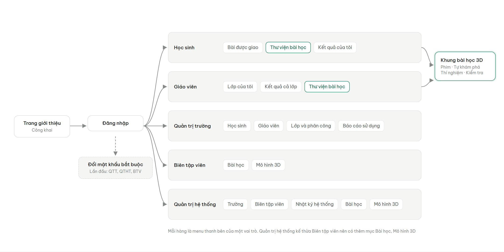

### 3.2.3. Thiết kế các màn hình chính

Các hình dưới đây là bản phác thảo giao diện với dữ liệu mẫu, dùng làm căn cứ để đội phát triển xây dựng. Màu sắc, kích thước cụ thể theo quy ước ở mục 3.2.1.

**1. Trang giới thiệu**

*Hình 3-2. Trang giới thiệu*

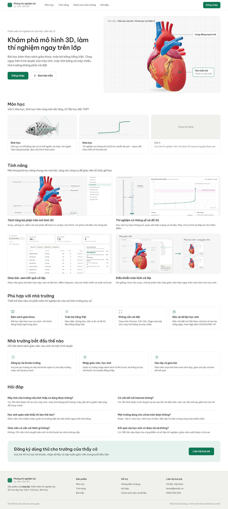

Trang đầu tiên khi truy cập hệ thống, ai cũng xem được, không cần đăng nhập. Trang cuộn dọc gồm các phần: (1) phần mở đầu với câu giới thiệu, nút "Đăng nhập", nút "Xem bài mẫu" và mô hình 3D có nhãn trên nền lưới ô li; (2) ba môn Sinh học, Hóa học, Vật lí kèm bài tiêu biểu (môn chưa có bài ghi rõ "Đang xây dựng"); (3) bốn tính năng chính kèm ảnh màn hình thật: tách bộ phận trên mô hình 3D, thí nghiệm có thông số và đồ thị, giao bài và xem kết quả cả lớp, điều khiển màn hình cả lớp; (4) các điểm phù hợp với nhà trường: bám sách giáo khoa, toàn bộ tiếng Việt, không cần cài đặt, bảo vệ dữ liệu học sinh theo Nghị định 13/2023/NĐ-CP; (5) ba bước để nhà trường bắt đầu; (6) hỏi đáp; (7) lời mời đăng ký dùng thử; (8) chân trang ghi công ty phát triển InoLink, thông tin liên hệ, liên kết hướng dẫn và chính sách bảo vệ dữ liệu. Trang dùng nội dung cố định, không gọi API. *UC: không có (trang xem).*

**2. Màn hình đăng nhập**

*Hình 3-3. Màn hình đăng nhập*

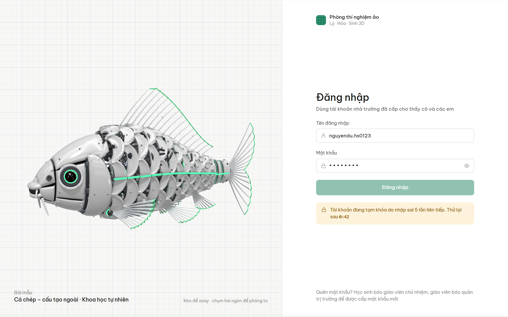

Màn hình gồm ô tên đăng nhập, ô mật khẩu (có nút hiện/ẩn) và nút Đăng nhập; bên trái là ảnh mô hình 3D giới thiệu hệ thống. Thông báo lỗi hiện ngay dưới nút: sai thông tin thì báo chung "Tên đăng nhập hoặc mật khẩu không đúng"; bị khóa tạm thì báo thời gian còn lại và đếm ngược. Tài khoản phải đổi mật khẩu được chuyển sang màn hình đổi mật khẩu bắt buộc, chỉ có ba ô mật khẩu và không có menu. *API: số 1, 4, 5. UC: 1, 2.*

**3. Thư viện bài học**

*Hình 3-4. Màn hình thư viện bài học*

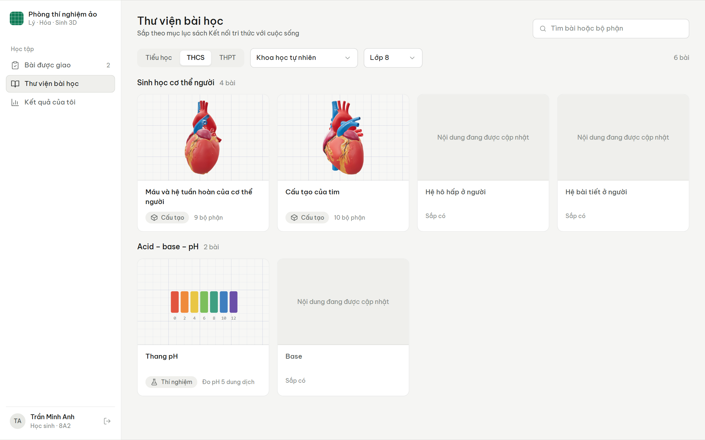

Bộ lọc theo cấp học, môn, lớp ở trên cùng, ô tìm kiếm theo tên bài hoặc tên bộ phận. Danh sách bài theo mục lục sách, nhóm theo chương; mỗi bài là một thẻ có ảnh đại diện, số bài, tên bài và nhãn loại bài (Cấu tạo / Thí nghiệm). Môn chưa có bài hiển thị "Nội dung đang được cập nhật". *API: số 7, 8. UC: 4.*

**4. Khung bài học 3D**

*Hình 3-5. Màn hình khung bài học 3D*

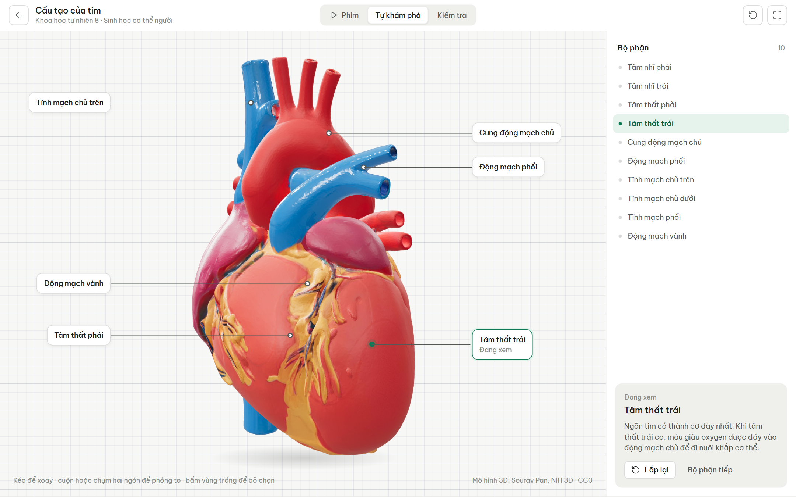

Mô hình 3D chiếm phần lớn màn hình trên nền lưới ô li; thanh trên có tên bài, ba chế độ Phim – Tự khám phá – Kiểm tra (thêm Thí nghiệm với bài thí nghiệm) và nút toàn màn hình. Cột phải là danh sách bộ phận; bấm vào bộ phận trên mô hình hoặc trong danh sách thì bộ phận được làm nổi bật, tách ra, và thẻ chú thích hiện bên cạnh. Dòng ghi công mô hình (nếu có) nằm ở góc dưới. Giáo viên có thêm nút "Điều khiển lớp"; khi đang bị giáo viên điều khiển, màn hình học sinh hiện dải thông báo "Thầy/cô đang điều khiển" và khóa thao tác xoay. *API: số 9, kênh WebSocket. UC: 5, 6, 13.*

**5. Thí nghiệm có thông số và đồ thị**

*Hình 3-6. Màn hình thí nghiệm chuẩn độ axit – bazơ*

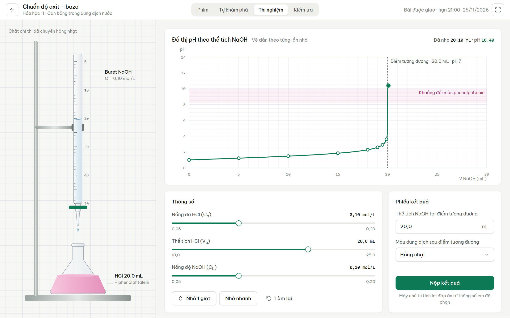

Bên trái là bộ dụng cụ 3D (buret, bình tam giác, màu chất chỉ thị thay đổi theo pH). Bên phải là bảng thông số (nồng độ HCl, thể tích ban đầu, nồng độ NaOH) với thanh trượt giới hạn trong khoảng cho phép, nút nhỏ từng giọt / nhỏ nhanh, đồ thị pH theo thể tích NaOH vẽ dần theo thao tác, và phiếu ghi kết quả. Bấm "Nộp kết quả" thì hiện điểm và đáp án máy chủ tính lại; mất kết nối thì giữ nguyên số liệu kèm nút "Nộp lại". *API: số 10. UC: 7.*

**6. Bài kiểm tra nhanh**

*Hình 3-7. Màn hình bài kiểm tra nhanh*

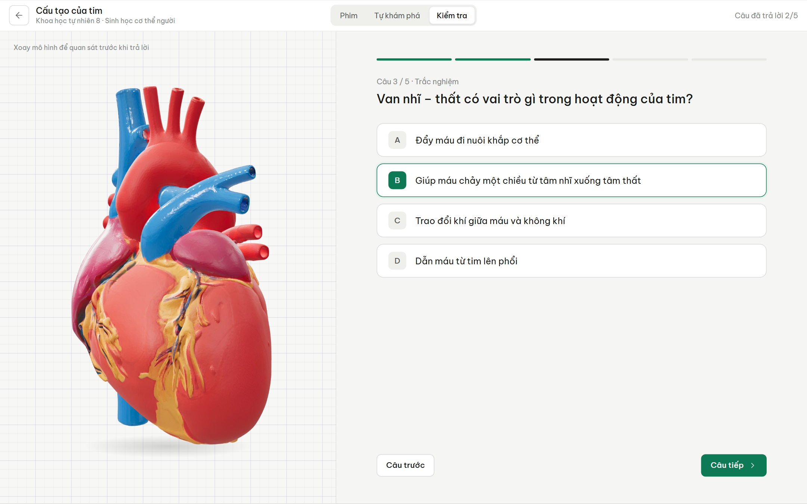

Mỗi lần hiện một câu; thanh tiến độ cho biết câu thứ mấy trên tổng số câu. Câu trắc nghiệm có bốn phương án A, B, C, D dạng nút lớn; câu chọn bộ phận cho học sinh bấm trực tiếp lên mô hình; câu nhập số có ô nhập kèm đơn vị. Nộp khi còn câu chưa làm thì hệ thống nhắc. Sau khi nộp hiện điểm và đáp án đúng từng câu. *API: số 9, 10. UC: 8.*

**7. Lớp của tôi và giao bài**

*Hình 3-8. Màn hình lớp của tôi và hộp thoại giao bài*

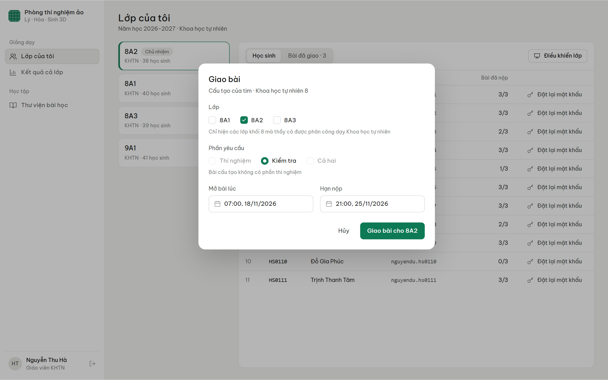

Bên trái là danh sách lớp, môn giáo viên được phân công (đánh dấu lớp chủ nhiệm). Chọn lớp thì hiện danh sách học sinh và số bài đã nộp; giáo viên chủ nhiệm có thêm nút đặt lại mật khẩu ở từng học sinh. Hộp thoại "Giao bài" chỉ liệt kê các lớp hợp lệ với bài, có chọn phần yêu cầu (thí nghiệm, kiểm tra hoặc cả hai), thời gian mở và hạn nộp. *API: số 6, 14, 15, 16, 17. UC: 3, 10, 11.*

**8. Kết quả cả lớp**

*Hình 3-9. Màn hình kết quả cả lớp*

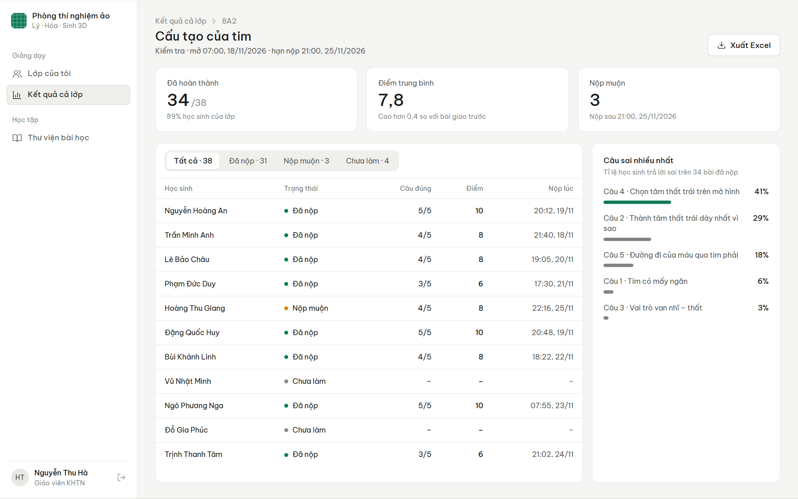

Trên cùng là ba con số: tỉ lệ hoàn thành, điểm trung bình, số học sinh nộp muộn. Bên dưới là bảng từng học sinh (trạng thái, điểm, số liệu thí nghiệm chính, thời điểm nộp), sắp xếp và lọc được theo trạng thái; cạnh đó là danh sách các câu sai nhiều nhất kèm thanh tỉ lệ. Nút "Xuất Excel" ở góc phải. *API: số 19, 20. UC: 12.*

**9. Nhập học sinh từ Excel**

*Hình 3-10. Màn hình nhập học sinh từ Excel*

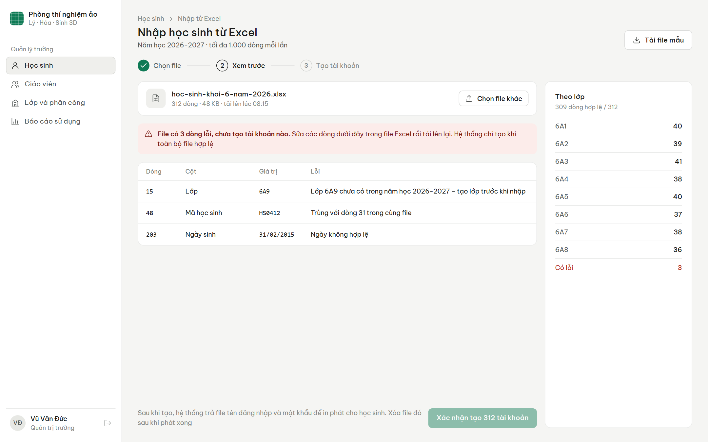

Màn hình chia ba bước có đánh số: (1) tải file mẫu và chọn file, (2) xem trước – nếu file có lỗi thì hiện bảng các dòng lỗi kèm lý do và nút chọn lại file; nếu hợp lệ thì hiện số học sinh theo từng lớp, (3) xác nhận tạo và tải file tài khoản, kèm lời nhắc xóa file sau khi phát tài khoản cho học sinh. *API: số 26, 27, 28. UC: 15.*

**10. Soạn bài và gắn nhãn bộ phận**

*Hình 3-11. Màn hình soạn bài và gắn nhãn bộ phận*

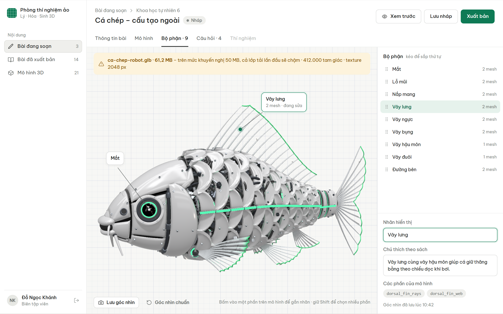

Thanh trên có tên bài, trạng thái (Nháp / Đã xuất bản), nút Xem trước, Lưu nháp và Xuất bản. Các thẻ chuyển giữa Thông tin bài – Mô hình – Bộ phận – Câu hỏi – Thí nghiệm. Ở thẻ Bộ phận, biên tập viên bấm vào phần trên mô hình, nhập nhãn và chú thích ở cột phải, bấm "Lưu góc nhìn" để ghi góc camera; danh sách bộ phận kéo thả được để sắp thứ tự. Bấm Xuất bản khi bài còn thiếu thì hộp thoại liệt kê các phần còn thiếu. Nạp mô hình mới hiện báo cáo kiểm tra (dung lượng, số tam giác, texture) với các chỉ số vượt mức cảnh báo được tô vàng. *API: số 46, 47, 51, 52, 54, 56. UC: 20, 21, 22.*

**11. Quản lý trường**

*Hình 3-12. Màn hình quản lý trường*

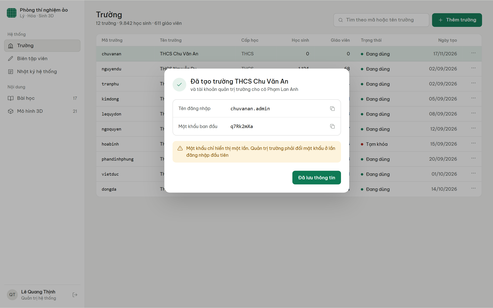

Bảng các trường gồm mã trường, tên, cấp học, số học sinh, số giáo viên, trạng thái (Đang dùng / Tạm khóa). Nút "Thêm trường" mở biểu mẫu thông tin trường và họ tên quản trị trường đầu tiên; sau khi lưu, hộp thoại hiện tên đăng nhập và mật khẩu ban đầu một lần, kèm nút sao chép. Xóa trường chỉ bật khi trường đã khóa, và yêu cầu gõ lại mã trường để xác nhận. *API: số 60 – 69. UC: 24.*

### 3.2.4. Các màn hình khác

Các màn hình còn lại có dạng danh sách và biểu mẫu, dùng lại bố cục và thành phần của các màn hình trên, nên không vẽ riêng.

*Bảng 3-15. Các màn hình khác*

| Màn hình | Vai trò | Dựa trên bố cục | API | UC |
|---|---|---|---|---|
| Phim mở đầu | HS, GV | Khung bài học (Hình 3-5), chế độ Phim có nút tạm dừng, tua | 9 | 5 |
| Bài được giao | HS | Thư viện bài học (Hình 3-4), mỗi thẻ thêm hạn nộp và trạng thái | 11 | 9 |
| Kết quả của tôi | HS | Bảng như Hình 3-9, chỉ một học sinh | 12, 13 | 9 |
| Đổi mật khẩu | Mọi | Biểu mẫu như Hình 3-3 | 5 | 2 |
| Quản lý học sinh | QTT | Bảng như Hình 3-12, lọc theo khối, lớp | 22 – 25 | 14 |
| Quản lý giáo viên, nhập giáo viên từ Excel | QTT | Như Hình 3-12 và Hình 3-10 | 29 – 35 | 16, 17 |
| Lớp và phân công giảng dạy | QTT | Như Hình 3-8, thêm bảng phân công | 36 – 42 | 18 |
| Báo cáo sử dụng của trường | QTT | Như Hình 3-9, tổng hợp theo lớp, theo môn | 43, 44 | 19 |
| Thư viện mô hình 3D | BTV, QTHT | Bảng như Hình 3-12, cột chỉ số kỹ thuật | 45 – 48 | 21 |
| Soạn câu hỏi | BTV, QTHT | Thẻ Câu hỏi trong Hình 3-11 | 57 – 59 | 23 |
| Quản lý biên tập viên | QTHT | Bảng như Hình 3-12 | 70 – 73 | 25 |
| Nhật ký hệ thống | QTHT | Bảng có bộ lọc thời gian, trường, người thực hiện, loại hành động | 74 | 26 |

## 3.3. Kết chương

Chương 3 đã hoàn thiện thiết kế hai lớp giao tiếp của hệ thống. Về **API**, hệ thống có 73 API REST và một kênh WebSocket, chia thành sáu nhóm theo vai trò, phủ đủ 26 Use Case. Các API dùng chung quy ước về đường dẫn, mã trạng thái, khuôn dạng lỗi tiếng Việt và phân trang. Bảo mật được đảm bảo ở nhiều lớp: access token ngắn hạn kết hợp refresh token trong cookie httpOnly có thể thu hồi, vai trò kiểm tra ở Router, phạm vi trường và lớp kiểm tra ở Service, schema đầu ra ngăn đáp án lọt xuống máy học sinh, máy chủ tự chấm lại kết quả thí nghiệm. Về **giao diện**, các quy ước chung về màu sắc, chữ, khoảng cách và trạng thái giúp mọi màn hình nhất quán. Mười một màn hình chính được phác thảo với dữ liệu mẫu, các màn hình còn lại dùng lại bố cục đã có.

Cùng với thiết kế CSDL ở chương 2, đây là căn cứ để đội phát triển bắt đầu lập trình theo kế hoạch triển khai: trưởng nhóm dựng nền tảng và chốt quy ước API; hai lập trình viên làm song song phần bài học 3D và phần quản lý dựa trên cùng bộ API đã đặc tả.
